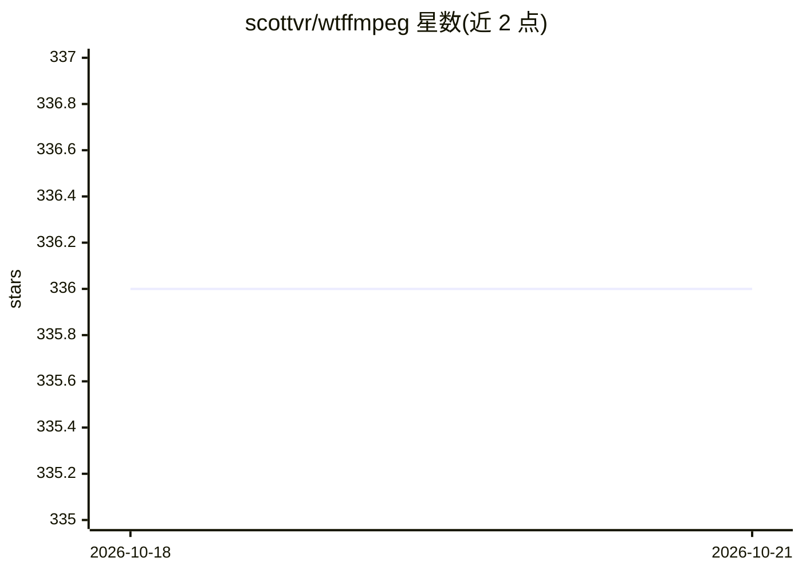

# scottvr/wtffmpeg

⭐ 336 · Python · MIT · 推送 2026-08-02 · [GitHub](https://github.com/scottvr/wtffmpeg) · [官网](http://scottvr.github.io/wtffmpeg/) · 个人维护

**用 LLM 把自然语言转成可执行 ffmpeg 命令的终端 REPL 工具**

命令行 REPL 工具 wtffmpeg（命令 wtff）：调用本地或远程 LLM，将英文描述的音视频处理任务翻译为可执行的 ffmpeg 命令，用户自行选择执行、复制或不执行，工具本身不代为执行。REPL 保留完整对话上下文（支持'照刚才那样'式引用），提供 shell 式上下箭头历史（可配置过滤提示词/命令）、!子 shell 命令、/斜杠命令、会话转录（~/.wtffmpeg/transcript.jsonl）与 /raw 查看完整模型响应，支持可替换的系统提示词 profile。面向熟悉命令行但不想反复查文档拼 ffmpeg 参数的用户，需系统已安装 ffmpeg。

## 筛选速览

| 维度 | 判定 | 备注 |
|---|---|---|
| AI 角色 | `ai-native` | 本体是模型或模型工具 |
| 许可风险 | `permissive` | MIT |
| 部署形态 | `library` | 以包/库形式分发 |
| 模型依赖 | — | README 未给出锁定关系 |
| 硬件要求 | — | 无带数字的原话,不猜 |
| 安装摩擦 | `medium` | 含编译或系统依赖之一 |
| 成熟度 | `idea` | |

## 能力要点

- 自然语言生成 ffmpeg 命令，执行决定权保留在用户手中
- REPL 保留对话上下文，支持增量式修改上一条命令
- 历史导航可配置（prompt/command/all）并支持修饰键实时过滤
- 完整模型响应保存在会话转录中，可用 /raw 与 ctrl-t 面板查看

## 适用场景

- 不想查 Stack Overflow 手拼 ffmpeg 参数的音视频处理任务
- 通过多轮对话逐步调优复杂的 ffmpeg 命令
- 在终端里探索 ffmpeg 用法并留存命令历史

## 场景标签

 · 领域:开发者工具/音视频处理

## 证据(README 行号)

> L11: `wtffmpeg` is a command-line tool that uses a Large Language Model (LLM) to translate plain-English descriptions of
> L23: To help with that, `wtffmpeg` is designed to help you get what you want by saying what you want. It is not a "GUI f

## 星数曲线

2026-10-18 336 → 2026-10-21 336（+0）

---
*卡片 v1 · prompt 1.4 · 生成 2026-10-22 · 置信度 high · 依据 README sha `4f1d405551b7` · [字段定义](../../DATASET.md)*
