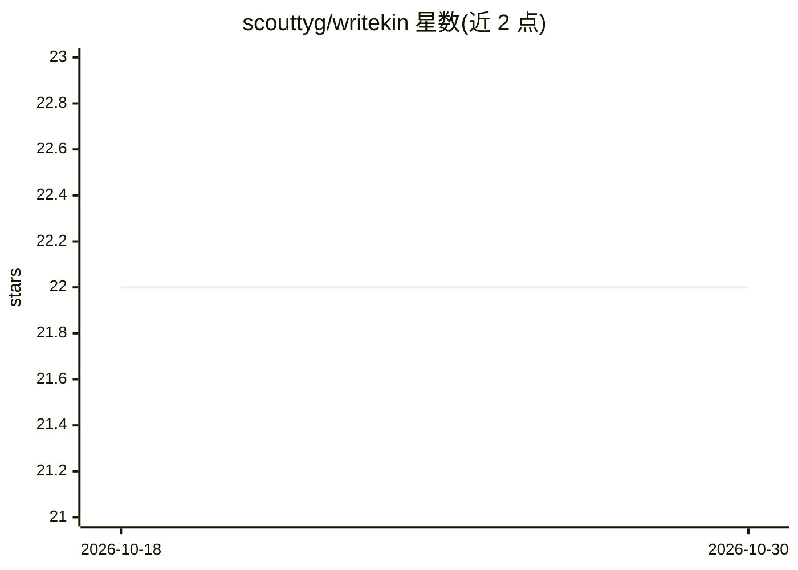

# scouttyg/writekin

⭐ 22 · Swift · NOASSERTION · 推送 2026-07-28 · [GitHub](https://github.com/scouttyg/writekin) · [官网](https://scouttyg.github.io/writekin/) · 个人维护

**在 Mac 上本地微调并生成个人文风文本的应用**

macOS 桌面应用：读取用户自己的 Mail、Messages、文档与聊天导出，整理成训练语料，在 Apple Silicon 上以 MLX + QLoRA 微调本地模型，随后用该模型以用户文风起草和改写文本。摄取、训练与生成全部在本机完成，无遥测与账号；模型权重按需从 Hugging Face 下载。要求 Apple Silicon Mac、16GB 统一内存（训练更大模型建议 32GB+）、macOS 14 及以上，Mail/Messages 摄取需用户授予完全磁盘访问权限。提供 DMG 安装包，也可用 xcodegen 从源码构建。源码可获取，许可为个人非商业免费（L75）。

## 筛选速览

| 维度 | 判定 | 备注 |
|---|---|---|
| AI 角色 | `ai-native` | 本体是模型或模型工具 |
| 许可风险 | `none` | NOASSERTION |
| 部署形态 | `None` |  |
| 模型依赖 | — | README 未给出锁定关系 |
| 硬件要求 | — | 无带数字的原话,不猜 |
| 安装摩擦 | `medium` | 含编译或系统依赖之一 |
| 成熟度 | — | 结构信号不足 |

## 能力要点

- 摄取 Mail/Messages/文档构建个人语料
- 本地 QLoRA 微调（Apple Silicon 上的 MLX）
- 训练与生成全程离线，无遥测、无账号
- 以用户文风起草与改写文本（Compose）

## 适用场景

- 用我自己的邮件和聊天记录训练出像我写作风格的模型
- 在不上传任何数据的前提下生成个人文风草稿
- 在 Mac 上管理多个本地微调模型

## 场景标签

`微调` `AI 写作` · 领域:内容生成

## 证据(README 行号)

> L3: **Writing that's kin to yours.** Writekin ingests your own writing —
> L5: corpus, fine-tunes a local language model (QLoRA on Apple Silicon via
> L29: - **Nothing leaves your machine.** Ingestion, training, and generation

## 星数曲线

2026-10-18 22 → 2026-10-30 22（+0）

---
*卡片 v1 · prompt 1.4 · 生成 2026-10-28 · 置信度 high · 依据 README sha `b5b981bfed8e` · [字段定义](../../DATASET.md)*
