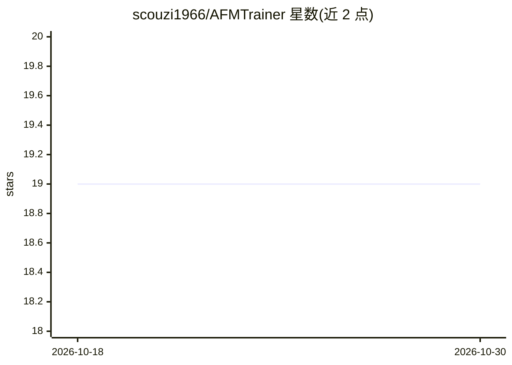

# scouzi1966/AFMTrainer

⭐ 19 · Python · NOASSERTION · 推送 2026-06-10 · [GitHub](https://github.com/scouzi1966/AFMTrainer) · 个人维护

**训练 Apple 端侧基础模型 LoRA 适配器的图形界面工具**

为 Apple Foundation Models Adapter Training Toolkit 提供的 GUI 封装应用：通过 Setup/Training/Export/Monitor 四个标签页完成数据集校验（JSONL 格式）、训练参数配置、适配器导出（.fmadapter）与实时监控（进度条、日志流、loss 追踪）。面向持有 Apple Developer Program 授权（需自行从 Apple 下载工具包）的开发者。依赖 UV 自动管理环境（约需 1GB 磁盘），macOS 用 Metal、Linux 用 CUDA 的 PyTorch。WandB 集成尚未测试。可绕过 GUI 用命令行直接训练。

## 筛选速览

| 维度 | 判定 | 备注 |
|---|---|---|
| AI 角色 | `ai-ecosystem` | LLM/agent 周边工具 |
| 许可风险 | `none` | NOASSERTION |
| 部署形态 | `None` |  |
| 模型依赖 | — | README 未给出锁定关系 |
| 硬件要求 | — | 无带数字的原话,不猜 |
| 安装摩擦 | `medium` | 含编译或系统依赖之一 |
| 成熟度 | — | 结构信号不足 |

## 能力要点

- 数据集校验（格式错误、token 统计、角色分布）与预览
- 训练参数实时校验，支持 bf16/f16 混合精度与激活检查点
- 实时监控：进度条、流式日志、loss 追踪与完成时间估算
- 配置文件保存/加载与命令行训练模式（可绕过 GUI）

## 适用场景

- 为 Apple 端侧基础模型训练并导出 LoRA 适配器
- 在 GUI 中校验 JSONL 对话数据集并监控训练过程
- 用 afm 命令在 macOS Beta 26+ 上测试训练好的适配器

## 场景标签

`微调` · 领域:训练与推理

## 证据(README 行号)

> L17: A comprehensive GUI wrapper application for Apple's Foundation Models Adapter Training Toolkit, providing an intuit
> L43: - **🔄 Complete Workflow**: From dataset validation to .fmadapter export

## 星数曲线

2026-10-18 19 → 2026-10-30 19（+0）

---
*卡片 v1 · prompt 1.4 · 生成 2026-10-28 · 置信度 high · 依据 README sha `def8c8f20c6c` · [字段定义](../../DATASET.md)*
