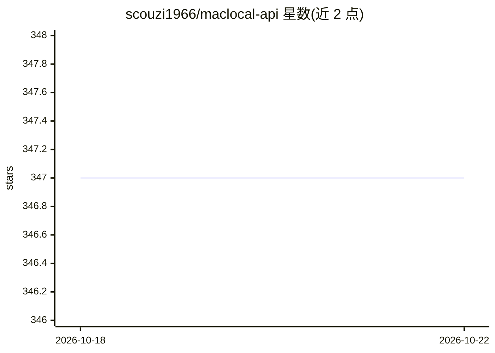

# scouzi1966/maclocal-api

⭐ 347 · Swift · MIT · 推送 2026-10-11 · [GitHub](https://github.com/scouzi1966/maclocal-api) · 个人维护

**把 Apple Silicon Mac 变成本地 OpenAI 兼容 AI 服务器的 CLI**

Swift 编写的 macOS 本地推理服务：通过 `afm` 命令启动本地 OpenAI 兼容端点，可运行 Hugging Face MLX 模型、Apple 设备端 Foundation Model 与 DwarfStar 检查点，另有网关模式聚合 Ollama、LM Studio、Jan 等本地服务器。提供对话/补全、流式、工具调用、结构化输出、嵌入、OCR、语音转写/合成、文本生图等端点，内置 WebUI、终端 TUI 聊天与 91 项变体的本地模型评测套件。要求 Swift 6.2+ 与 macOS 26+，MLX 权重首次使用时从 Hugging Face 下载。

## 筛选速览

| 维度 | 判定 | 备注 |
|---|---|---|
| AI 角色 | `ai-ecosystem` | LLM/agent 周边工具 |
| 许可风险 | `permissive` | MIT |
| 部署形态 | `library` | 以包/库形式分发 |
| 模型依赖 | — | README 未给出锁定关系 |
| 硬件要求 | — | 无带数字的原话,不猜 |
| 安装摩擦 | `low` | 无编译、无系统依赖或容器化 |
| 成熟度 | — | 结构信号不足 |

## 能力要点

- 本地 OpenAI 兼容服务器，无需云账号或 API key
- 支持 MLX / Apple Foundation Models / DwarfStar 三种运行时与网关模式
- 端点覆盖 chat、embeddings、OCR、语音转写与合成、FLUX.2 Klein 生图
- 原生工具调用格式自动检测、结构化输出与 radix-tree KV 前缀缓存

## 适用场景

- 在 Mac 上本地跑 MLX 或 Apple Foundation Model 并接入现有 OpenAI 客户端
- 为 Cline、Aider、Cursor 等编码工具提供私有本地推理后端
- 用单条命令评测本地 MLX 模型并生成 HTML 报告
- 通过网关模式统一聚合 Ollama/LM Studio 等本地服务

## 场景标签

 · 领域:本地 LLM 基础设施

## 证据(README 行号)

> L37: AFM turns an Apple Silicon Mac into a private, OpenAI-compatible AI server. Run Hugging Face MLX models or Apple’s 
> L101: AFM is now listening at `http://127.0.0.1:9999/v1`.
> L173: |**Gateway**|One model list for Ollama, LM Studio, Jan, and other local servers|`afm --gateway`|

## 星数曲线

2026-10-18 347 → 2026-10-22 347（+0）

---
*卡片 v1 · prompt 1.4 · 生成 2026-10-22 · 置信度 high · 依据 README sha `379093cd6053` · [字段定义](../../DATASET.md)*
