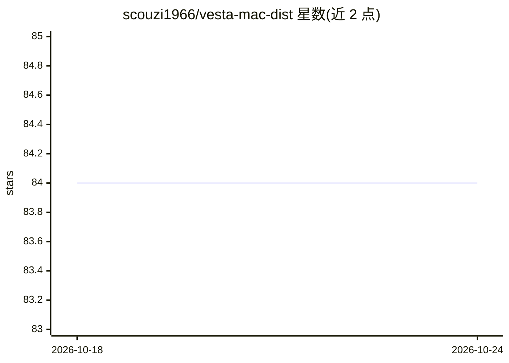

# scouzi1966/vesta-mac-dist

⭐ 84 · 推送 2026-05-09 · [GitHub](https://github.com/scouzi1966/vesta-mac-dist) · 个人维护

**macOS 本地多后端 AI 聊天应用（Apple Silicon）**

Vesta 是面向 macOS Tahoe（26.0+）Apple Silicon 用户的 SwiftUI AI 聊天应用，同时支持五个后端：Apple Intelligence、MLX、llama.cpp、HuggingFace 云推理与 OpenAI 兼容 API（可接 LM Studio、Ollama），支持运行时切换。功能含视觉理解（Qwen3-VL）、TTS/STT、图像与视频生成，并内置 MCP server（41+ 工具）供 Claude Code 等以自然语言控制应用。本地后端离线处理数据，云后端需联网。以 Homebrew cask 或 DMG 分发，Developer ID 签名并公证。已知 Qwen3-VL 模型存在循环生成问题（模型行为）。本仓库为分发仓库，源码在 vesta-mac。

## 筛选速览

| 维度 | 判定 | 备注 |
|---|---|---|
| AI 角色 | `ai-native` | 本体是模型或模型工具 |
| 许可风险 | `none` | — |
| 部署形态 | `desktop` | 安装包/桌面程序 |
| 模型依赖 | local-ok | 支持本地模型 |
| 硬件要求 | — | 无带数字的原话,不猜 |
| 安装摩擦 | `low` | 无编译、无系统依赖或容器化 |
| 成熟度 | — | 结构信号不足 |

## 能力要点

- 5 个后端同时启用并支持运行时切换（Apple Intelligence/MLX/llama.cpp/HuggingFace/OpenAI 兼容）
- 内置 MCP server（41+ 工具、TCP 环回 + token 认证），可由 Claude Code 作为 agent 控制
- WhisperKit 端上语音转文字（Tiny 至 Large V3，28+ 语言）；Kokoro/Marvis TTS（含语音克隆）
- DMG 签名公证、App Sandbox，本地后端数据不出设备

## 适用场景

- 在 Mac 上本地运行 GGUF/MLX 模型进行对话与图像理解
- 通过语音输入与 AI 对话并获得语音朗读
- 让 Claude Code 通过 MCP 自动化操作聊天应用与模型管理

## 场景标签

`聊天机器人` `语音合成` `视频生成` · 领域:对话与助手

## 证据(README 行号)

> L25: Vesta is a multi-backend AI chat application for macOS that runs models locally on Apple Silicon. It supports five 
> L156: - **Apple Intelligence** -- on-device AI via Foundation Models framework (always available)

## 星数曲线

2026-10-18 84 → 2026-10-24 84（+0）

---
*卡片 v1 · prompt 1.4 · 生成 2026-10-24 · 置信度 high · 依据 README sha `d1c1876119bb` · [字段定义](../../DATASET.md)*
