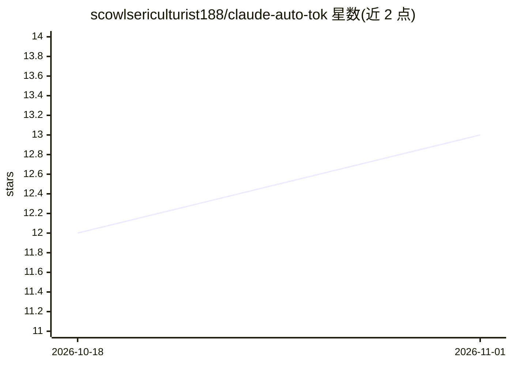

# scowlsericulturist188/claude-auto-tok

⭐ 13 · TypeScript · 推送 2026-10-14 · [GitHub](https://github.com/scowlsericulturist188/claude-auto-tok) · 个人维护

**Windows 桌面应用：用六个 AI 代理自动生成 TikTok 短视频**

面向 Windows 10/11 用户的视频生成桌面应用：输入一个主题，多个 AI 代理分工完成选题规划、脚本撰写、钩子与节奏设计、配音、场景组织与最终 MP4 渲染，输出竖屏短视频及脚本、音频、场景文件等产物。需要用户在设置中填入 Claude、Gemini、OpenRouter、ElevenLabs 等服务密钥；通过 GitHub 上的 zip 包下载安装，最低 8 GB 内存、5 GB 磁盘与稳定网络。

## 筛选速览

| 维度 | 判定 | 备注 |
|---|---|---|
| AI 角色 | `ai-native` | 本体是模型或模型工具 |
| 许可风险 | `none` | — |
| 部署形态 | `desktop` | 安装包/桌面程序 |
| 模型依赖 | locked-api |  |
| 硬件要求 | — | 无带数字的原话,不猜 |
| 安装摩擦 | `low` | 无编译、无系统依赖或容器化 |
| 成熟度 | — | 结构信号不足 |

## 能力要点

- 多代理流水线：规划、脚本、钩子、配音、场景、渲染分工
- 从主题/提示词生成竖屏短视频与配套脚本音频文件
- 支持 Claude、Gemini、OpenRouter、ElevenLabs 等服务密钥接入
- 项目文件夹保存后可重跑同一创意做修改

## 适用场景

- 把一个想法快速变成 TikTok 风格的短视频
- 批量产出配音解说的竖屏短视频内容
- 用可复用项目快速测试不同选题与节奏

## 场景标签

`多智能体` `视频生成` · 领域:Agent 开发

## 证据(README 行号)

> L17: claude-auto-tok helps you make TikTok-style videos from a simple idea or prompt. It uses a chain of AI agents to ha
> L81: The app uses multiple agents to split the work into smaller jobs:

## 星数曲线

2026-10-18 12 → 2026-11-01 13（+1）

---
*卡片 v1 · prompt 1.4 · 生成 2026-10-31 · 置信度 high · 依据 README sha `865df04a96a0` · [字段定义](../../DATASET.md)*
