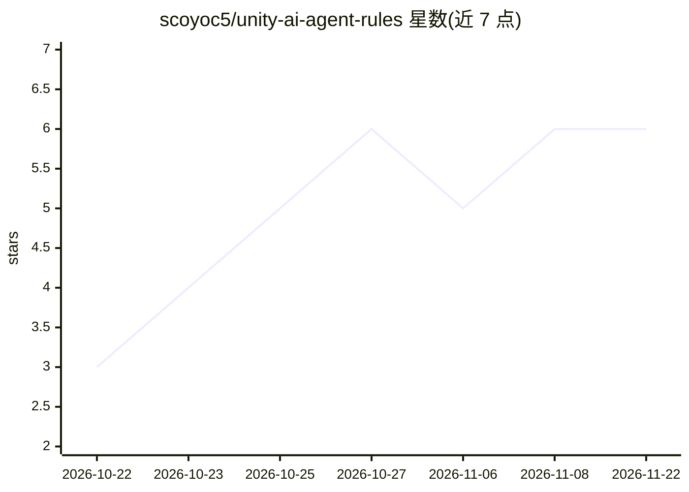

# scoyoc5/unity-ai-agent-rules

⭐ 6 · MIT · 推送 2026-11-19 · [GitHub](https://github.com/scoyoc5/unity-ai-agent-rules) · [官网](https://johnvanscoyoc.itch.io/unity-ai-agent-kit-rules-prompts-workflow-for-cursor-and-claude-code) · 个人维护

**给 Unity 开发者的规则集：防止 AI 编码工具写出错误 C#**

为 Unity C# 项目提供一组 Cursor rules 与 AGENTS.md 规则文件，用于约束 AI 编码工具的常见错误：遗漏 using 指令、编造不存在的 API、混淆 Unity 6 与 2022.3 LTS 的 API 差异。文件复制到项目根目录后 Cursor 自动读取，Claude Code、Codex 等 agent 读取 AGENTS.md，ChatGPT/Claude 网页对话可粘贴 PRIMING_HEADER.md。也可作为 Cursor 插件安装。配套提供 Unity 6 vs 2022.3 快速参考表。核心规则集免费，另有付费完整版 Unity AI Agent Kit 在 itch.io 出售。

## 筛选速览

| 维度 | 判定 | 备注 |
|---|---|---|
| AI 角色 | `ai-ecosystem` | LLM/agent 周边工具 |
| 许可风险 | `permissive` | MIT |
| 部署形态 | `None` |  |
| 模型依赖 | — | README 未给出锁定关系 |
| 硬件要求 | — | 无带数字的原话,不猜 |
| 安装摩擦 | `low` | 无编译、无系统依赖或容器化 |
| 成熟度 | — | 结构信号不足 |

## 能力要点

- 覆盖缺失 using、编造 API、Unity 6/2022.3 混淆三类常见 AI 编码错误
- 同时适配 Cursor rules、AGENTS.md 与 ChatGPT/Claude 粘贴式头部
- 含 Unity 6 vs 2022.3 LTS API 差异对照表
- 可与 Unity CLI 1.0 配合使用，规则要求先读取 ProjectVersion.txt 再改代码

## 适用场景

- 在 Unity 项目中让 Cursor/Claude Code 按 Unity 版本规范写代码
- 团队向 AI agent 下发统一的 C# 编码约束规则
- 避免 AI 修改脚本后出现 CS0246 等 using 缺失编译错误

## 场景标签

`编码 Agent` `提示工程` · 领域:Agent 开发

## 证据(README 行号)

> L3: Cursor rules and an `AGENTS.md` that stop the most common AI coding mistakes in Unity C#:
> L9: Works with **Cursor**, **Claude Code**, and any agent that reads `AGENTS.md`. There's also a paste-in header for Cha
> L24: |`AGENTS.md`|The same guidance for Claude Code, Codex and other agents|

## 星数曲线

2026-10-22 3 → 2026-11-22 6（+3）

---
*卡片 v1 · prompt 1.4 · 生成 2026-11-20 · 置信度 high · 依据 README sha `0efc921ae2fc` · [字段定义](../../DATASET.md)*
