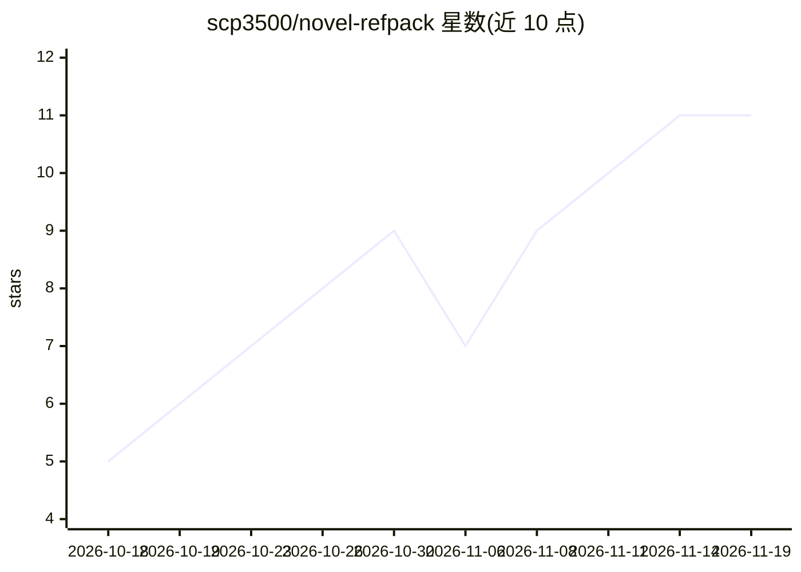

# scp3500/novel-refpack

⭐ 11 · Python · MIT · 推送 2026-11-15 · [GitHub](https://github.com/scp3500/novel-refpack) · 个人维护 · 中文 README

**把长篇小说加工成 LLM 续写/仿写用参考包的流水线**

面向十万到几百万字的小说/剧本/系列文，通过本地切片与分片纪要脚本加工出三份产物：整书总结（事实圣经）、例子集（文风语料）与合并后的单文件参考包，直接粘贴给大模型用于续写、IF 线或原创仿写。支持五种创作模式（含去剧情脱敏的纯文风包、反 AI 腔负面约束、贴吧人设蒸馏），可用 --preset/--kb/--max-tokens 按上下文窗口控制输出体积与文风/摘要配比；可由 Coding Agent 调度子代理并行跑分片，也可脱离 Agent 用外部 API 批处理。

## 筛选速览

| 维度 | 判定 | 备注 |
|---|---|---|
| AI 角色 | `ai-knowledge` | 知识聚合/清单类 |
| 许可风险 | `permissive` | MIT |
| 部署形态 | `None` |  |
| 模型依赖 | — | README 未给出锁定关系 |
| 硬件要求 | — | 无带数字的原话,不猜 |
| 安装摩擦 | `low` | 无编译、无系统依赖或容器化 |
| 成熟度 | — | 结构信号不足 |

## 能力要点

- 输出整书总结+例子集+一键合并参考包三类文件，带 KB/Tokens/占比看板
- 按上下文窗口分 compact/standard/rich/full 预设档位，可自定义体积与 70:30 默认配比
- 纯文风模式本地剥离剧情并人名脱敏，无需 LLM 调用
- 支持 Coding Agent 子代理并行调度与外部 API 两种运行方式

## 适用场景

- 给长篇同人续写或 IF 分歧线准备事实与文风参考
- 从某位作家语料拟合文风，写全新原创世界观
- 洗掉大模型写作中的机械套话与公文过渡词
- 为群聊/贴吧拟真人设蒸馏 System Prompt

## 场景标签

`提示工程` `AI 写作` · 领域:Agent 开发

## 证据(README 行号)

> L3: 把一本长篇小说（十万到几百万字）加工成轻量参考包，直接喂给大模型用于续写、IF 线或原创文风仿写：
> L46: - 做全书事实 + 文风包：先跑 `00_extract.py` 与 `01_split.py` 本地切片，再派子代理并行跑分片纪要与卷纪要，最后跑 `06`~`13` 总装输出。

## 星数曲线

2026-10-18 5 → 2026-11-19 11（+6）

---
*卡片 v1 · prompt 1.4 · 生成 2026-11-18 · 置信度 mid · 依据 README sha `6fa510a8ff7b` · [字段定义](../../DATASET.md)*
