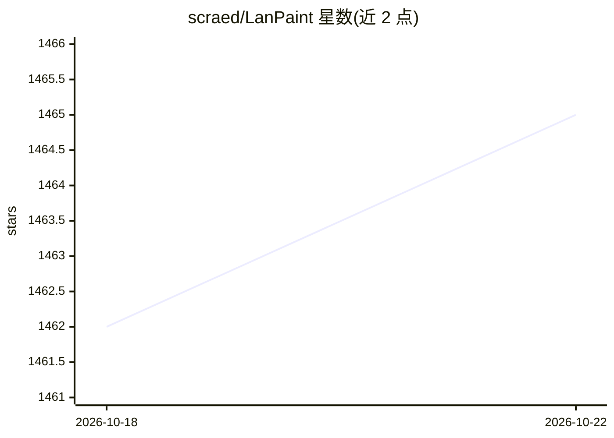

# scraed/LanPaint

⭐ 1,466 · Python · GPL-3.0 · 推送 2026-09-28 · [GitHub](https://github.com/scraed/LanPaint) · 个人维护

**ComfyUI 通用的免训练局部重绘采样器节点**

以 ComfyUI 自定义节点形式提供的免训练 inpainting 采样器：通过多轮迭代'思考'后再去噪的部分条件采样，让预训练扩散/整流模型无需微调即可做掩码约束的图像与视频局部重绘、外绘、局部编辑，兼容 Ideogram4、Krea2、Z-Image、Wan 2.2、Qwen Image 2.1、Flux、SD 系列等模型。提供逐帧视频掩码编辑器与 MiniMax H3 视频+音频联合重绘管线，掩码可嵌入 mp4 元数据。限制：蒸馏模型（如 Flux.dev）性能下降；视频重绘建议 40 帧以内。

## 筛选速览

| 维度 | 判定 | 备注 |
|---|---|---|
| AI 角色 | `ai-ecosystem` | LLM/agent 周边工具 |
| 许可风险 | `viral` | GPL-3.0 |
| 部署形态 | `None` |  |
| 模型依赖 | — | README 未给出锁定关系 |
| 硬件要求 | — | 无带数字的原话,不猜 |
| 安装摩擦 | `low` | 无编译、无系统依赖或容器化 |
| 成熟度 | — | 结构信号不足 |

## 能力要点

- 免训练、免反传的部分条件采样，适配多种扩散与整流模型
- 逐帧视频掩码编辑器，关键帧间自动插值
- MiniMax H3 视频+音频单次联合重绘管线（AVEncode/AVDecode）
- 掩码可导出嵌入 mp4 元数据，加载时自动恢复

## 适用场景

- 在 ComfyUI 里对图片做掩码局部重绘或外绘
- 对视频逐帧画掩码做局部编辑或扩展画面边界
- 配合 MiniMax H3 同时重绘视频画面与音频区间

## 场景标签

 · 领域:图像/视频生成与编辑

## 证据(README 行号)

> L111: - **Universal Compatibility** – Works instantly with almost any model (**Ideogram4, Krea2, Z-image, Z-image-base, 
> L24: LanPaint is a training-free partial conditional sampler that enables mask-constrained inpainting and local editing 

## 星数曲线

2026-10-18 1,462 → 2026-10-22 1,465（+3）

---
*卡片 v1 · prompt 1.4 · 生成 2026-10-21 · 置信度 high · 依据 README sha `bacc1e5a806a` · [字段定义](../../DATASET.md)*
