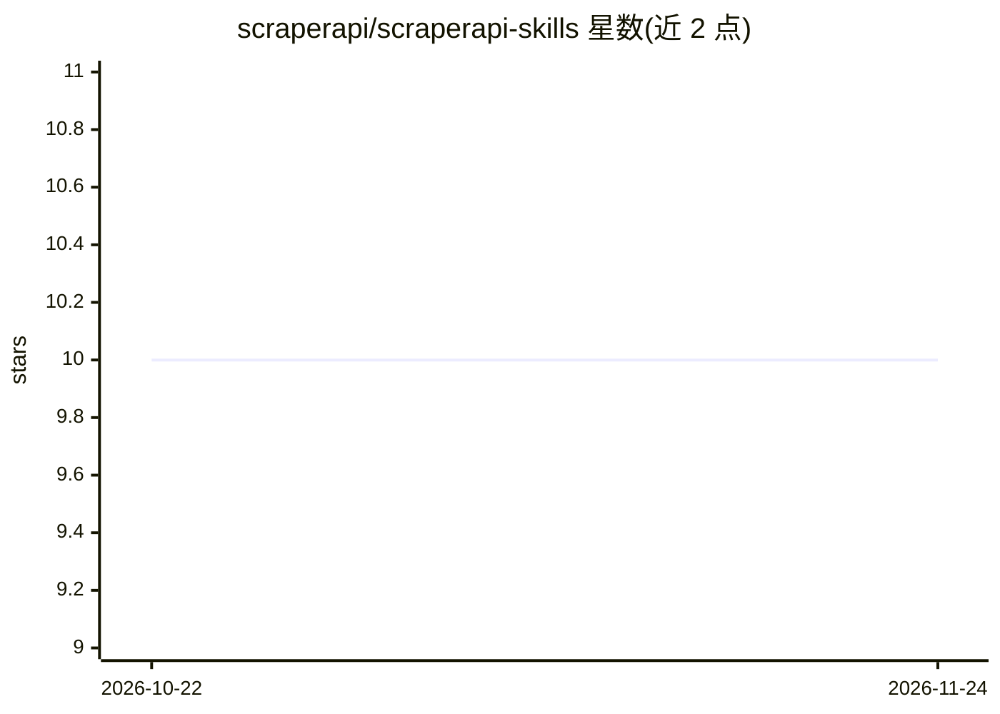

# scraperapi/scraperapi-skills

⭐ 10 · Python · MIT · 推送 2026-11-20 · [GitHub](https://github.com/scraperapi/scraperapi-skills) · 组织维护

**为 Claude Code agent 提供 ScraperAPI 全套网页抓取技能**

ScraperAPI 官方 Claude Code 插件，将 22 个 MCP 工具与一组 agent 技能打包：产品选型引导（Standard API/Async Jobs/Crawler/DataPipeline）、五种语言 SDK 最佳实践、官方 CLI、n8n 工作流生成，以及抓取器构建、线索补全、自主研究、市场研究、SEO 审计、SERP 分析、价格监控等即用工作流。通过 marketplace、Claude Plugin Hub（npx）或 OpenClaw（ClawHub）安装，需 ScraperAPI API key，技能在 Claude Code 会话中由自然语言触发。

## 筛选速览

| 维度 | 判定 | 备注 |
|---|---|---|
| AI 角色 | `ai-ecosystem` | LLM/agent 周边工具 |
| 许可风险 | `permissive` | MIT |
| 部署形态 | `library` | 以包/库形式分发 |
| 模型依赖 | locked-api |  |
| 硬件要求 | — | 无带数字的原话,不猜 |
| 安装摩擦 | `low` | 无编译、无系统依赖或容器化 |
| 成熟度 | — | 结构信号不足 |

## 能力要点

- 内含 ScraperAPI 托管 MCP 服务器，向 agent 提供 22 个 MCP 工具
- 覆盖 Python/Node.js/Ruby/PHP/Java 五种 SDK 的最佳实践技能
- 提供自主研究工作流：抓取页面上传 Anthropic Files API 后交 Claude 生成带引用报告
- 支持 Claude Code marketplace、npx claudepluginhub、OpenClaw 三种安装途径

## 适用场景

- 让 agent 抓取并分析网页数据做市场或竞品研究
- 监控 Amazon/Walmart/Google Shopping 商品价格变动
- 基于实时 SERP 数据做 SEO 审计与关键词分析

## 场景标签

`网页抓取` · 领域:效率与自动化

## 证据(README 行号)

> L5: ScraperAPI's official Claude Code plugin — a growing library of agent skills that cover the full ScraperAPI surface:
> L29: The plugin ships with ScraperAPI's hosted MCP server so all 22 MCP tools become available to the agent, authed via 

## 星数曲线

2026-10-22 10 → 2026-11-24 10（+0）

---
*卡片 v1 · prompt 1.4 · 生成 2026-11-19 · 置信度 high · 依据 README sha `e393d0115c15` · [字段定义](../../DATASET.md)*
