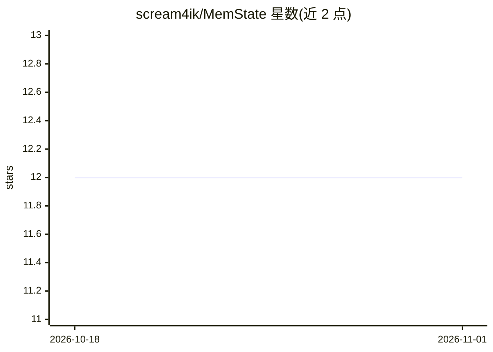

# scream4ik/MemState

⭐ 12 · Python · Apache-2.0 · 推送 2026-03-30 · [GitHub](https://github.com/scream4ik/MemState) · 个人维护

**AI Agent 记忆一致性层：SQL 与向量库同步提交/回滚**

面向 AI agent 记忆存储的 Python 库，定位为 agent 与存储之间的一致性层：将数据库事务机制扩展到向量库，SQL 与向量库（ChromaDB/Qdrant）同 commit 同 rollback，避免“Split-Brain”记忆漂移。提供 Pydantic 类型校验、混合检索（向量语义+SQL 事实过滤）、rollback(n) 时间回溯，支持 asyncio。存储后端含 SQLite/PostgreSQL(JSONB)/Redis/内存，并给出 LangGraph 原生 Checkpointer 与 LangChain 集成。README 自述 Beta，附故障注入基准脚本。

## 筛选速览

| 维度 | 判定 | 备注 |
|---|---|---|
| AI 角色 | `ai-ecosystem` | LLM/agent 周边工具 |
| 许可风险 | `permissive` | Apache-2.0 |
| 部署形态 | `library` | 以包/库形式分发 |
| 模型依赖 | — | README 未给出锁定关系 |
| 硬件要求 | — | 无带数字的原话,不猜 |
| 安装摩擦 | `low` | 无编译、无系统依赖或容器化 |
| 成熟度 | `idea` | |

## 能力要点

- SQL 与向量库原子提交，一方失败双方回滚
- rollback(n) 时间回溯，支持用户纠正
- Pydantic 校验防止 LLM 破坏 JSON schema
- LangGraph 原生 Checkpointer 集成，FastAPI 异步可用

## 适用场景

- 我的 agent 记忆在 SQL 和向量库各存一份，需要保证两者一致
- 用户纠正后回滚 agent 的记忆变更
- 在 FastAPI/LangGraph 应用中接入带事务保障的记忆层

## 场景标签

`Agent 记忆` · 领域:Agent 开发

## 证据(README 行号)

> L6: > **Mental Model:** MemState extends **database transactions** to your Vector DB.
> L48: MemState acts as a **Consistency Layer** between your agent and its storage.
> L50: * **Atomic Commits:** SQL and Vector DB stay in sync. If one fails, both rollback.

## 星数曲线

2026-10-18 12 → 2026-11-01 12（+0）

---
*卡片 v1 · prompt 1.4 · 生成 2026-11-01 · 置信度 high · 依据 README sha `8972e05ef70b` · [字段定义](../../DATASET.md)*
