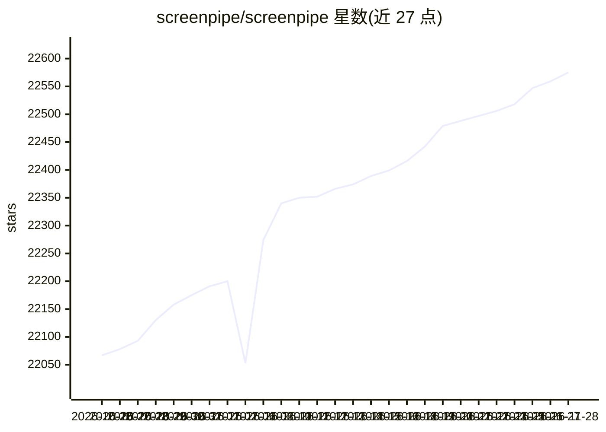

# screenpipe/screenpipe

⭐ 22,575 · Rust · NOASSERTION · 推送 2026-11-27 · [GitHub](https://github.com/screenpipe/screenpipe) · [官网](https://screenpipe.com) · 组织维护

**本地录屏+转写构建可审查工作流，交给任意 agent 自动化**

本地持续记录屏幕与音频：事件驱动截图（可访问性树优先、OCR 兜底）、本地 Whisper 转写与说话人识别，历史存于 SQLite 支持自然语言搜索与时间线回放。在上层发现重复工作流并生成带证据的发现报告，用户审查后可通过 MCP、REST API、SDK 或 pipes 交给现有 agent/自动化工具运行。桌面应用支持 macOS/Windows/Linux，提供 npx CLI；个人非商业使用免费，商业使用需购买许可。

## 筛选速览

| 维度 | 判定 | 备注 |
|---|---|---|
| AI 角色 | `ai-enhanced` | 去掉 AI 部分产品仍成立 |
| 许可风险 | `none` | NOASSERTION |
| 部署形态 | `desktop` | 安装包/桌面程序 |
| 模型依赖 | local-ok | 支持本地模型 |
| 硬件要求 | — | 无带数字的原话,不猜 |
| 安装摩擦 | `low` | 无编译、无系统依赖或容器化 |
| 成熟度 | — | 结构信号不足 |

## 动量与使用信号

- 维护:`active` — 距上次 push 1.3 天,年发版 100,159 位贡献者
- 涨星:近 1 天 **+12**(自 20261016 起算)
- 安装:npm 包 `screenpipe` 月下载 26,560
- 平台:WINDOWS / MACOS / LINUX · 协议:OPENAI-API / MCP / OLLAMA

## 能力要点

- 事件驱动捕获：可访问性树+OCR 兜底+键盘/应用切换记录
- 本地 Whisper (Large-V3-Turbo) 实时转写，Deepgram 云端可选
- 工作流发现报告：步骤、决策、异常与源捕获证据回链
- 经 MCP/REST API/SDK/pipes 交接给任意 agent

## 适用场景

- 找出我每周重复执行的工作并整理成可自动化的流程
- 自然语言搜索我看过/听过的所有屏幕与会议内容
- 给 Cursor/Claude Code 等编码助手提供工作上下文
- 远程办公自动生成会议转写与笔记

## 场景标签

`工作流自动化` `知识库管理` `语音识别` `OCR` · 领域:效率与自动化

## 证据(README 行号)

> L41: screenpipe records computer work locally and turns it into workflows you can review and hand off.
> L74: - **Any harness**: Screenpipe Cloud, Zapier, n8n, Claude Code, Codex, or an agent you run yourself
> L185: screenpipe is a source-available application that records screen and audio locally and turns that history into sea

## 星数曲线

2026-10-26 22,067 → 2026-11-28 22,575（+508）

---
*卡片 v1 · prompt 1.4 · 生成 2026-11-27 · 置信度 high · 依据 README sha `965b5a02e306` · [字段定义](../../DATASET.md)*
