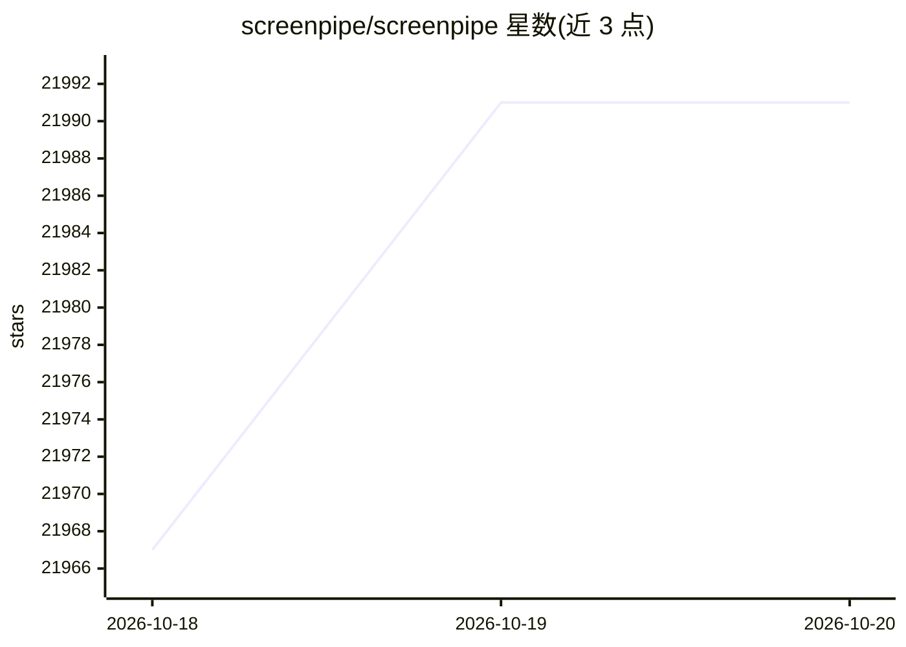

# screenpipe/screenpipe

⭐ 21,991 · Rust · NOASSERTION · 推送 2026-10-19 · [GitHub](https://github.com/screenpipe/screenpipe) · [官网](https://screenpipe.com) · 组织维护 · 中文 README

**持续录制电脑屏幕与音频，为企业/个人构建可搜索的 AI 记忆**

本地持续捕获屏幕与音频的应用：事件驱动截屏（配 accessibility tree，OCR 兜底）、Whisper 本地语音转写与说话人识别、自然语言检索（SQLite FTS5）、时间线回放。通过 Markdown 定义的 Pipes 运行 AI agent（如 meeting-summary、day-recap），带 YAML 确定性数据权限控制；以 MCP server 与 localhost REST API 向 AI 助手暴露屏幕历史。source-available 许可：个人非商用免费，商用需购买许可。桌面应用支持 macOS/Windows/Linux，也可经 CLI 运行。

## 筛选速览

| 维度 | 判定 | 备注 |
|---|---|---|
| AI 角色 | `ai-enhanced` | 去掉 AI 部分产品仍成立 |
| 许可风险 | `dual` | NOASSERTION |
| 部署形态 | `desktop` | 安装包/桌面程序 |
| 模型依赖 | — | README 未给出锁定关系 |
| 硬件要求 | — | 无带数字的原话,不猜 |
| 安装摩擦 | `low` | 无编译、无系统依赖或容器化 |
| 成熟度 | — | 结构信号不足 |

## 动量与使用信号

- 维护:`active` — 距上次 push 1.3 天,年发版 100,159 位贡献者
- 涨星:近 1 天 **+12**(自 20261016 起算)
- 安装:npm 包 `screenpipe` 月下载 26,560
- 平台:WINDOWS / MACOS / LINUX · 协议:OPENAI-API / MCP / OLLAMA

## 能力要点

- 事件驱动截屏 + accessibility tree/OCR 兜底，本地 Whisper (Large-V3-Turbo) 转写
- Pipes 插件系统：markdown 定义的定时 AI agent，含三层确定性数据权限
- MCP server 零配置接入 Claude Desktop、Cursor 等 MCP 客户端
- localhost REST API 与 JS/TS SDK，支持原始 SQL 访问 SQLite

## 适用场景

- 回忆/检索自己在电脑上看过的内容与会议录音
- 给 AI 编码助手提供工作上下文
- 自动生成会议纪要、每日总结与时间分配报告
- 分析团队工作流，找出可自动化的环节

## 场景标签

`语音识别` `OCR` `多模态` `Agent 记忆` · 领域:Agent 开发

## 证据(README 行号)

> L12:  Continuously record your company's computer work, map workflows, help find work worth automating, and power agents
> L51: - **Local-first** - capture history stays on your device by default. Cloud AI, sync, integrations, and managed team
> L166: - **License**: Screenpipe Commercial License (source-available; personal, non-commercial use permitted, commercial

## 星数曲线

2026-10-18 21,967 → 2026-10-20 21,991（+24）

---
*卡片 v1 · prompt 1.4 · 生成 2026-10-18 · 置信度 high · 依据 README sha `0241ed1383ce` · [字段定义](../../DATASET.md)*
