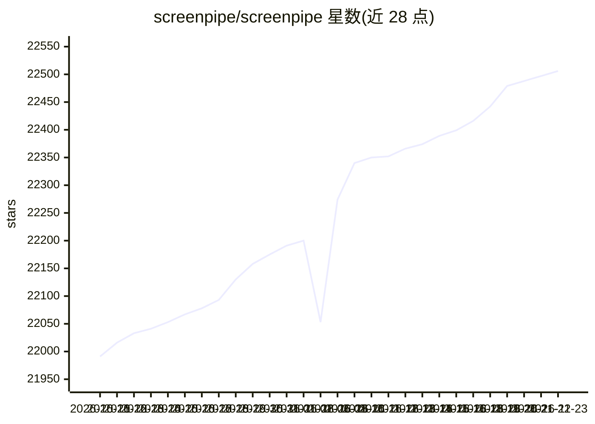

# screenpipe/screenpipe

⭐ 22,506 · Rust · NOASSERTION · 推送 2026-11-21 · [GitHub](https://github.com/screenpipe/screenpipe) · [官网](https://screenpipe.com) · 组织维护

**本地连续录屏工具：发现重复工作流并交给 AI agent**

screenpipe 在本地持续录制屏幕与音频，将历史转为可检索上下文与工作流：事件驱动的截图捕获（accessibility tree 优先、OCR 兜底）、本地 Whisper 语音转写、自然语言搜索（SQLite FTS5）、时间线回放，以及以 markdown 定义的 Pipes 计划型 agent。工作流发现报告梳理触发器、步骤与例外，经人工审阅后可经 MCP、REST API、SDK 或 pipe 交给外部 agent 执行。捕获数据默认留在本机，云 AI、同步与团队存储为独立数据路径。许可证为 source-available 商业许可，个人非商业使用免费。

## 筛选速览

| 维度 | 判定 | 备注 |
|---|---|---|
| AI 角色 | `ai-native` | 本体是模型或模型工具 |
| 许可风险 | `none` | NOASSERTION |
| 部署形态 | `desktop` | 安装包/桌面程序 |
| 模型依赖 | local-ok | 支持本地模型 |
| 硬件要求 | — | 无带数字的原话,不猜 |
| 安装摩擦 | `low` | 无编译、无系统依赖或容器化 |
| 成熟度 | — | 结构信号不足 |

## 动量与使用信号

- 维护:`active` — 距上次 push 1.3 天,年发版 100,159 位贡献者
- 涨星:近 1 天 **+12**(自 20261016 起算)
- 安装:npm 包 `screenpipe` 月下载 26,560
- 平台:WINDOWS / MACOS / LINUX · 协议:OPENAI-API / MCP / OLLAMA

## 能力要点

- 事件驱动捕获：截图配 accessibility tree，OCR 兜底，降低 CPU 与存储占用
- 本地 Whisper Large-V3-Turbo 转写，支持说话人分离，Deepgram 为云端选项
- Pipes：以 markdown 文件定义的计划型 AI agent（会议纪要、日报、站会更新）
- 工作流经 MCP/REST API/SDK 交付给用户已有的 agent 与自动化工具

## 适用场景

- 回溯查找我在电脑上看过、听过的任意内容
- 整理会议记录并生成会议摘要
- 找出我每周重复做的工作流程并交给 agent 自动化
- 给 Cursor、Claude Code 等编码助手提供工作上下文

## 场景标签

`工作流自动化` `语音识别` `OCR` · 领域:效率与自动化

## 证据(README 行号)

> L12:  Continuously record computer work locally, discover recurring workflows, and hand the result to any agent you alre
> L180: screenpipe is a source-available application that records screen and audio locally and turns that history into sea
> L232: Pipes are scheduled AI agents defined as markdown files. Each pipe is a `pipe.md` with a prompt and schedule — scr

## 星数曲线

2026-10-21 21,991 → 2026-11-23 22,506（+515）

---
*卡片 v1 · prompt 1.4 · 生成 2026-11-22 · 置信度 high · 依据 README sha `fb93ec353c1a` · [字段定义](../../DATASET.md)*
