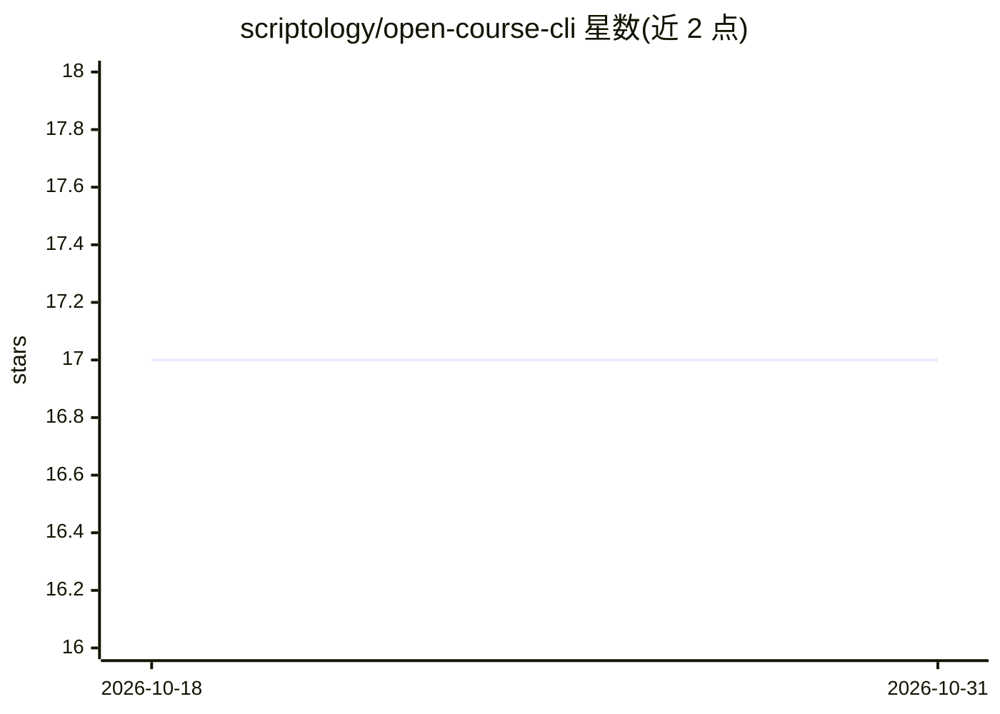

# scriptology/open-course-cli

⭐ 17 · Rust · Apache-2.0 · 推送 2026-09-21 · [GitHub](https://github.com/scriptology/open-course-cli) · [官网](https://open-course.eu) · 组织维护

**终端语言学习 AI 导师：LLM 生成课程、练习与答案分析**

Rust 编写的终端（TUI）语言学习应用：用户配置母语/目标语言、CEFR 水平与 LLM 提供商后，由所选 LLM 生成课程主题与翻译练习批次，批后分析答案、更新评分，并按间隔重复跟踪薄弱主题与微学习条目。数据按语言对隔离存储于本地 LanceDB，支持云端同步与 web 端账号互通。开箱支持 OpenAI、Anthropic、Gemini、DeepSeek、Mistral、OpenRouter、Ollama 及任意 OpenAI 兼容端点。提供安装脚本二进制与 cargo 两种安装方式，发布覆盖 macOS（Apple Silicon/Intel）与 Linux x86_64。

## 筛选速览

| 维度 | 判定 | 备注 |
|---|---|---|
| AI 角色 | `ai-native` | 本体是模型或模型工具 |
| 许可风险 | `permissive` | Apache-2.0 |
| 部署形态 | `library` | 以包/库形式分发 |
| 模型依赖 | local-ok | 支持本地模型 |
| 硬件要求 | — | 无带数字的原话,不猜 |
| 安装摩擦 | `low` | 无编译、无系统依赖或容器化 |
| 成熟度 | — | 结构信号不足 |

## 能力要点

- LLM 生成课程、翻译练习与答案分析，含间隔重复复习
- 本地 LanceDB 按语言对存储进度/历史/复习数据
- 离线优先云同步，同账号支持 web 应用
- 支持 7 家提供商及任意 OpenAI 兼容 Custom 端点

## 适用场景

- 在终端中按 CEFR 水平进行个性化语言练习
- 用本地 Ollama 模型离线生成练习
- 跨设备同步学习进度（CLI 与 web 端）

## 场景标签

 · 领域:教育/语言学习

## 证据(README 行号)

> L3: Terminal AI tutor for language learning. Exercises, lessons, and answer analysis are generated by an LLM provider yo
> L76: 3. The LLM generates a batch of translation exercises for the chosen topic.
> L99: Supported out of the box: OpenAI, Anthropic, Google Gemini, DeepSeek, Mistral, OpenRouter, and Ollama. Any other Op

## 星数曲线

2026-10-18 17 → 2026-10-31 17（+0）

---
*卡片 v1 · prompt 1.4 · 生成 2026-10-29 · 置信度 high · 依据 README sha `a9aaf6290fee` · [字段定义](../../DATASET.md)*
