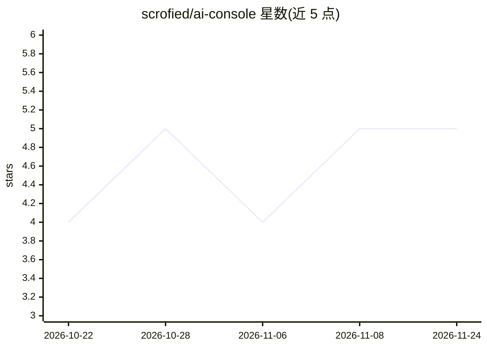

# scrofied/ai-console

⭐ — · [GitHub]() · 个人维护 · 中文 README

**把多个桌面 AI 工具编排成拆单-并行-交叉验收团队的指挥台**

基于 Bun 单进程、零 npm 依赖的本地工作台：用户输入一句目标后，指挥官工具拆成任务卡，派给 Codex/WorkBuddy/Qoder 等桌面 AI 并行执行，再由另一家工具做独立交叉验收，产出落盘回网页工作台。核心机制是以文件夹为总线，协作状态编码在文件名后缀里，靠原子改名完成交接，无需数据库、消息队列或 API Key 中转；聊天型 App 可通过 DONE 文件兜底参与。要求 Bun ≥ 1.3 和至少一个可用的 AI 工具 CLI 或桌面端，非生产级多租户系统。

## 筛选速览

| 维度 | 判定 | 备注 |
|---|---|---|
| AI 角色 | `ai-ecosystem` | LLM/agent 周边工具 |
| 许可风险 | `permissive` | — |
| 部署形态 | `None` |  |
| 模型依赖 | — | README 未给出锁定关系 |
| 硬件要求 | — | 无带数字的原话,不猜 |
| 安装摩擦 | `low` | 无编译、无系统依赖或容器化 |
| 成熟度 | — | 结构信号不足 |

## 能力要点

- 文件名后缀作状态机：改名即原子交接，无需锁服务与数据库
- 跨家交叉验收：新独立会话按'定义完成'条款逐条核验并给出文件与行号
- DONE 文件兜底让只能写自己目录的聊天型工具也能参与
- 会话续接：按工具与作用域维护 session id，支持 resume

## 适用场景

- 同时使用多个 AI 编程工具时统一派活与验收
- 把大目标拆成任务卡让多家 AI 并行执行
- 为流水线式固定分工建立可复用的流程模板

## 场景标签

`多智能体` `工作流自动化` `编码 Agent` · 领域:Agent 开发

## 证据(README 行号)

> L5: 把 **Codex / WorkBuddy / Qoder / TraeWork / 豆包** 这些桌面 AI 工具编成一支团队：一个当指挥官负责拆单派活，其余当工人并行干活，**换一家做交叉验收**，结果自动汇总回一个网页工作台。
> L97: - Bun ≥ 1.3（服务端**零 npm 依赖**，只用 `node:fs` / `node:path` 和 Bun 内置的 `Bun.serve` / `Bun.spawn`）

## 星数曲线

2026-10-22 4 → 2026-11-24 5（+1）

---
*卡片 v1 · prompt 1.4 · 生成 2026-11-21 · 置信度 high · 依据 README sha `be4745f14026` · [字段定义](../../DATASET.md)*
