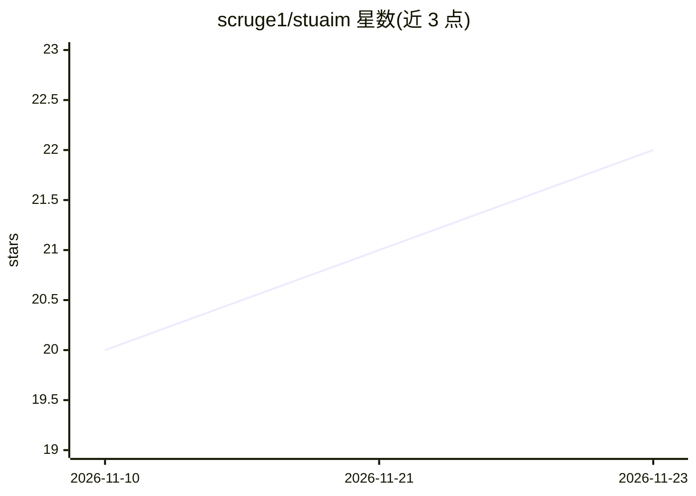

# scruge1/stuaim

⭐ 22 · Python · MIT · 推送 2026-11-09 · [GitHub](https://github.com/scruge1/stuaim) · 个人维护

**低显存本地模型的命令行 agent harness：项目控制与独立验证**

面向 Linux x86_64 的命令行 harness 与项目控制器，连接既有的本地 OpenAI 兼容模型端点（不内置模型下载）。由 Pi 驱动对话与工具调用，项目级控制器独立检查任务输出后才记录状态；提供源绑定记忆检索、有界上下文、安全恢复与任务看板适配。本地结果上限为 tested 状态，不能自我提升为外部 blessed。附带无需模型/GPU 的离线 SSOT 验证脚本。Windows/macOS 走能力不同的直接安装路径，桌面界面仍在开发中。

## 筛选速览

| 维度 | 判定 | 备注 |
|---|---|---|
| AI 角色 | `ai-ecosystem` | LLM/agent 周边工具 |
| 许可风险 | `permissive` | MIT |
| 部署形态 | `None` |  |
| 模型依赖 | — | README 未给出锁定关系 |
| 硬件要求 | — | 无带数字的原话,不猜 |
| 安装摩擦 | `low` | 无编译、无系统依赖或容器化 |
| 成熟度 | `idea` | |

## 能力要点

- 独立控制器在记录前检查任务输出，本地结果封顶为 tested
- 源绑定记忆检索与有界上下文
- 连接既有 OpenAI 兼容本地端点，模型下载与安装分离
- 离线验证脚本 verify_ssot_release.py 无需 GPU 或付费 API

## 适用场景

- 在低显存机器上运行有验证边界的本地编码 agent
- 需要任务输出经独立检查后才记入项目状态的工作流
- 无模型环境下检验 SSOT/验证器执行路径

## 场景标签

`编码 Agent` `Agent 记忆` · 领域:Agent 开发

## 证据(README 行号)

> L5: This repository contains the public command-line harness and project controller behind the STUAIM work. The managed 
> L26: The **complete bootstrap is for Linux x86_64 with glibc**. It attaches to an *existing* local OpenAI-compatible mod

## 星数曲线

2026-11-10 20 → 2026-11-23 22（+2）

---
*卡片 v1 · prompt 1.4 · 生成 2026-11-18 · 置信度 high · 依据 README sha `1471e24425a4` · [字段定义](../../DATASET.md)*
