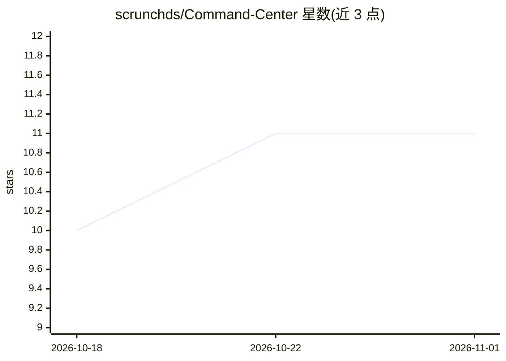

# scrunchds/Command-Center

⭐ 11 · TypeScript · MIT · 推送 2026-10-29 · [GitHub](https://github.com/scrunchds/Command-Center) · 个人维护

**面向 Obsidian 用户的本地优先 AI 多 agent 编排插件与个人运营中枢**

以 Obsidian 插件形式提供的个人运营系统：仪表盘聚合今日笔记、未归档捕获、任务与日历，全部由 Obsidian 元数据缓存计算、不消耗 token；在此之上提供 13 个模型提供商的统一调度层（含 Pi、Ollama、LM Studio 等本地选项）、本地 Pi ReAct 引擎（Orchestrator–Worker 循环）、BM25+语义混合 vault 检索、持久 agent 记忆、语音输入与实时转录、MCP/REST 连接器和 headless 自动化。所有写入操作经过绝对写入门控，需用户显式批准；桌面端专用（Desktop only）。安装依赖 Obsidian 与 Node.js 环境。

## 筛选速览

| 维度 | 判定 | 备注 |
|---|---|---|
| AI 角色 | `ai-native` | 本体是模型或模型工具 |
| 许可风险 | `permissive` | MIT |
| 部署形态 | `library` | 以包/库形式分发 |
| 模型依赖 | local-ok | 支持本地模型 |
| 硬件要求 | — | 无带数字的原话,不猜 |
| 安装摩擦 | `low` | 无编译、无系统依赖或容器化 |
| 成熟度 | — | 结构信号不足 |

## 能力要点

- 13 提供商统一调度：工作分类为 coding/vision/reading/reasoning/fast 并按延迟/成本路由
- 本地 Pi ReAct 引擎执行 Orchestrator→Worker→Observation→Correction 循环
- 绝对写入门控：所有 agent 写入需显式批准，带 diff 预览与追加式决策日志
- 零 token 仪表盘：仅读取 Obsidian metadataCache 生成态势快照

## 适用场景

- 把 Obsidian vault 变成可对话操控的个人任务与笔记中枢
- 在本地（Ollama/LM Studio/Pi）运行多 agent 工作流且控制写入权限
- 对 vault 内容做混合 RAG 检索并持久化 agent 记忆

## 场景标签

`多智能体` `Agent 记忆` `知识库管理` `RAG` · 领域:Agent 开发

## 证据(README 行号)

> L11: **Command Center is a personal operational OS for Obsidian — a local-first AI multi-agent orchestrator that turns y
> L79: Command Center exposes one dispatch layer across **13 providers**:
> L113: The ReAct runtime follows an **Orchestrator → Worker → Observation → Correction** loop:

## 星数曲线

2026-10-18 10 → 2026-11-01 11（+1）

---
*卡片 v1 · prompt 1.4 · 生成 2026-11-01 · 置信度 high · 依据 README sha `2ea35dc2107c` · [字段定义](../../DATASET.md)*
