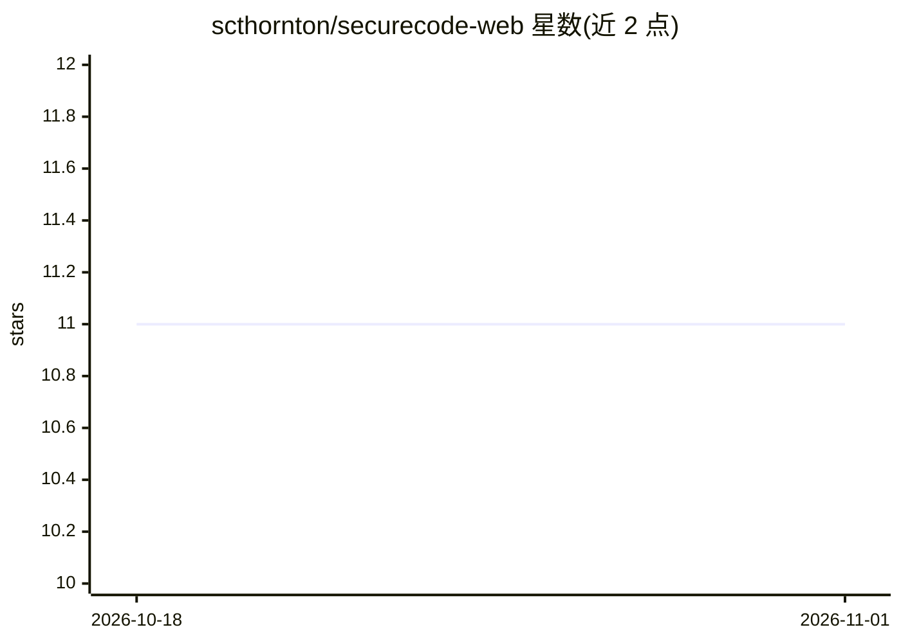

# scthornton/securecode-web

⭐ 11 · Python · NOASSERTION · 推送 2026-07-06 · [GitHub](https://github.com/scthornton/securecode-web) · 个人维护

**面向 AI 训练的 Web 安全漏洞对话数据集（1,650 例）**

SecureCode Web 是一个 Web 与应用安全训练数据集：v2.6 共 1,650 条样本（train 1,272 / validation 187 / test 191），采用 4 轮对话结构，覆盖 OWASP Top 10:2025、CSRF、XSS、SQL 注入、OAuth/OIDC、软件供应链等主题。每条样本带 CVE、EPSS/CVSS、MITRE ATT&CK/CAPEC、前置条件等可利用性元数据，且每个派生字段标注 source 与 confidence（measured/heuristic 等）。v2.2 审计移除了 802 个错误或虚构的 CVE 引用并置空关联 EPSS/CVSS 值；数据以 parquet 格式按 train/validation/test 划分提供，拆分考虑防泄漏。面向开展安全模型训练与评测的开发者和研究人员。

## 筛选速览

| 维度 | 判定 | 备注 |
|---|---|---|
| AI 角色 | `ai-knowledge` | 知识聚合/清单类 |
| 许可风险 | `none` | NOASSERTION |
| 部署形态 | `self-host` | docker 或自建部署 |
| 模型依赖 | — | README 未给出锁定关系 |
| 硬件要求 | — | 无带数字的原话,不猜 |
| 安装摩擦 | `low` | 无编译、无系统依赖或容器化 |
| 成熟度 | — | 结构信号不足 |

## 能力要点

- 1,650 条样本，4 轮对话结构，含 train/validation/test 划分
- EPSS/CVSS/CAPEC/ATT&CK/前置条件等可利用性元数据，带 source 与 confidence 标注
- v2.2 审计移除 802 个错误或虚构 CVE 并置空关联评分
- 覆盖 OWASP Top 10:2025 双字段（owasp_2021 与 owasp_2025 兼容迁移）

## 适用场景

- 训练或评测安全编码/漏洞检测类语言模型
- 构建基于真实 CVE 与事件的安全问答数据
- 研究漏洞可利用性评分（EPSS/CVSS）与攻击技术的关联

## 场景标签

`模型评测` `模型训练` · 领域:评测与运维

## 证据(README 行号)

> L6: task_categories:
> L199: **Production-grade web security vulnerability dataset with complete incident grounding, 4-turn conversational stru

## 星数曲线

2026-10-18 11 → 2026-11-01 11（+0）

---
*卡片 v1 · prompt 1.4 · 生成 2026-11-01 · 置信度 mid · 依据 README sha `e33f689052eb` · [字段定义](../../DATASET.md)*
