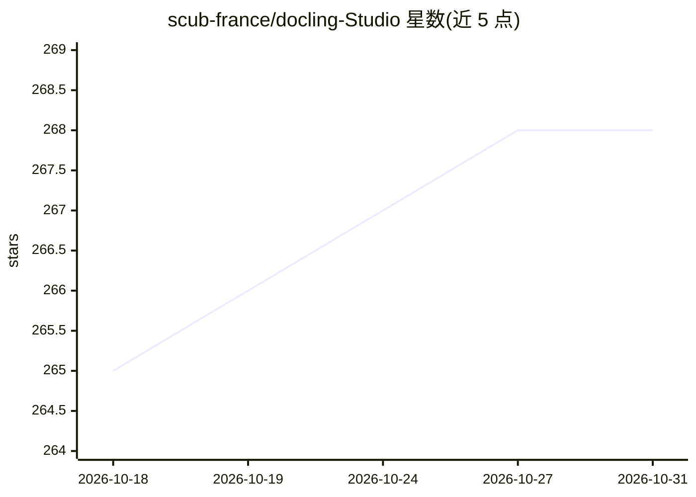

# scub-france/docling-Studio

⭐ 268 · Python · MIT · 推送 2026-10-28 · [GitHub](https://github.com/scub-france/docling-Studio) · [官网](https://scub-france.github.io/docling-Studio/) · 组织维护

**基于 Docling 的可视化文档解析工作台，可索引至 OpenSearch/Neo4j**

浏览器中上传 PDF 并配置 Docling 解析管线（OCR、表格结构、公式/代码增强、图片分类与 VLM 描述），可视化文本、表格、公式与边界框；支持分块后经嵌入索引到 OpenSearch（全文+向量检索），并可选将完整文档树镜像为 Neo4j 图（含 PARENT_OF 等关系与应用内图视图）。另含 R&D 级 Live Reasoning：通过 Ollama 运行 docling-agent 的 chunkless RAG 循环并渲染推理时间线。Docker 单命令启动，提供 local（约 1.9 GB，CPU-only）与 remote（约 270 MB，外接 Docling Serve）两种镜像；图视图对超 200 页文档返回 413。

## 筛选速览

| 维度 | 判定 | 备注 |
|---|---|---|
| AI 角色 | `ai-native` | 本体是模型或模型工具 |
| 许可风险 | `permissive` | MIT |
| 部署形态 | `self-host` | docker 或自建部署 |
| 模型依赖 | local-ok | 支持本地模型 |
| 硬件要求 | `cpu-ok` | |
| 安装摩擦 | `low` | 无编译、无系统依赖或容器化 |
| 成熟度 | — | 结构信号不足 |

## 能力要点

- 浏览器内配置 Docling 管线并可视化边界框、表格、公式
- 分块→嵌入→OpenSearch 向量/全文索引（一键、默认关闭）
- DoclingDocument 全树镜像为 Neo4j 图并提供 Cypher 查询与应用内图视图
- Live Reasoning：经 Ollama 运行 docling-agent chunkless RAG 并渲染推理时间线

## 适用场景

- 上传 PDF 并检查 Docling 解析管线的输出质量
- 把解析结果分块、嵌入并索引到 OpenSearch 供检索
- 用 Neo4j 图查询文档结构（如按章节找表格、追溯 chunk 来源）

## 场景标签

`文档解析` `知识图谱` `RAG` · 领域:知识与检索

## 证据(README 行号)

> L10: A visual document analysis studio powered by Docling.
> L21: - **Configurable Docling pipeline** — OCR, table extraction, code/formula enrichment, picture classification & desc
> L25: - **Ingestion pipeline** — Docling → chunking → embedding → OpenSearch vector indexing (one-click from Studio)

## 星数曲线

2026-10-18 265 → 2026-10-31 268（+3）

---
*卡片 v1 · prompt 1.4 · 生成 2026-10-22 · 置信度 mid · 依据 README sha `2168b30cd08a` · [字段定义](../../DATASET.md)*
