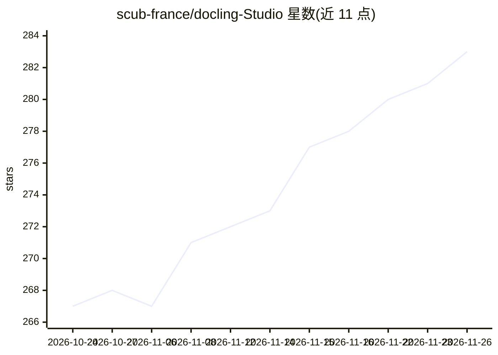

# scub-france/docling-Studio

⭐ 283 · Python · MIT · 推送 2026-11-23 · [GitHub](https://github.com/scub-france/docling-Studio) · [官网](https://pier-jean-docling-studio.hf.space/) · 组织维护

**解析 PDF 并让 AI agent 按需引用文档的 MCP 服务**

基于 Docling 的文档问答与检索工具：解析 PDF 后在页面上绘制每个元素（标题、段落、表格、图片）的边界框，并展示文档树；通过 MCP 让 Claude、Cursor 等 agent 客户端在 token 预算内只读取所需章节，并引用经服务端核验的原文段落，不依赖分块、嵌入或向量库。提供 Docker 镜像运行，无 GPU 要求，可导出 Markdown 或 Docling JSON；MCP 服务默认开启且无鉴权，需注意端口保护。

## 筛选速览

| 维度 | 判定 | 备注 |
|---|---|---|
| AI 角色 | `ai-native` | 本体是模型或模型工具 |
| 许可风险 | `permissive` | MIT |
| 部署形态 | `self-host` | docker 或自建部署 |
| 模型依赖 | local-ok | 支持本地模型 |
| 硬件要求 | — | 无带数字的原话,不猜 |
| 安装摩擦 | `low` | 无编译、无系统依赖或容器化 |
| 成熟度 | — | 结构信号不足 |

## 能力要点

- 无分块/嵌入/向量库的检索方式，按章节供给 agent 并引用服务端核验的段落
- 可视化 PDF 解析结果：元素边界框与文档树联动查看
- 内置 MCP 服务供 agent 读取与引用文档，可在设置中开关
- 可配合本地模型（Ollama）回答文档问题并展示推理步骤

## 适用场景

- 导入 PDF 并直观检查 Docling 提取出的标题、表格与图片框
- 让 Claude/Cursor 等 agent 按需读取长文档并引用原文
- 在本地用 Ollama 模型对文档做问答

## 场景标签

`文档解析` `文档问答` · 领域:知识与检索

## 证据(README 行号)

> L12: Docling Studio parses a PDF, then Claude answers from it over MCP, with cited sources
> L29: - Answers questions about a document with a local model (Ollama), and shows the steps it took.
> L31: - Lets AI agents read and cite your documents over MCP (on by default, no authentication: keep port 3000 private; s

## 星数曲线

2026-10-24 267 → 2026-11-26 283（+16）

---
*卡片 v1 · prompt 1.4 · 生成 2026-11-25 · 置信度 high · 依据 README sha `4971312dc694` · [字段定义](../../DATASET.md)*
