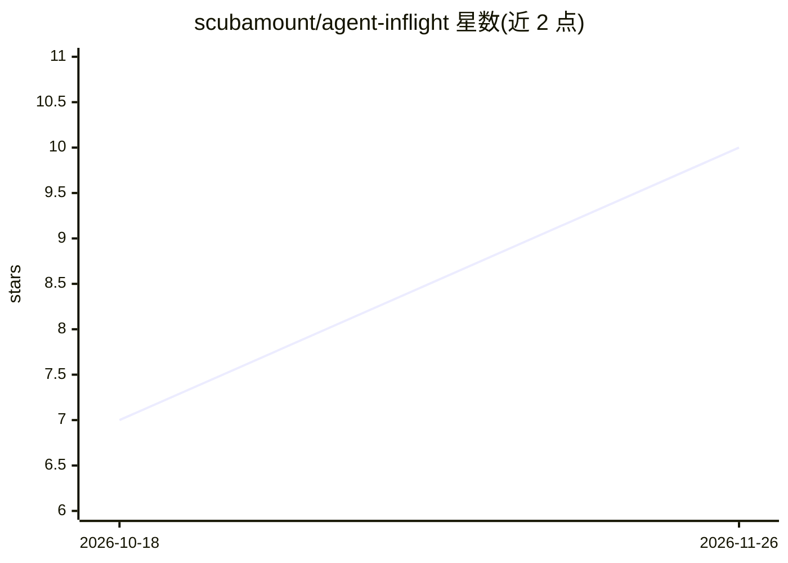

# scubamount/agent-inflight

⭐ 10 · Python · Apache-2.0 · 推送 2026-10-29 · [GitHub](https://github.com/scubamount/agent-inflight) · 个人维护

**为 AI 编码代理提供跨会话交接文件，追踪未完成工作**

以单个 Markdown 文件作为 AI 编码代理间的共享交接载体：记录未推送的提交、未重启的服务、待决策事项及其归属会话的活跃状态（ACTIVE/IDLE/ENDED），配合小型 CLI 写入带日期与会话标签的条目、生成限宽 brief、修剪归档。内置 Claude Code 与 Hermes 适配器，其他代理通过指令片段或 hook 协议接入。Stdlib Python 3.9+ 实现，无依赖、无网络、无守护进程，仅支持 Linux 与 macOS。

## 筛选速览

| 维度 | 判定 | 备注 |
|---|---|---|
| AI 角色 | `ai-ecosystem` | LLM/agent 周边工具 |
| 许可风险 | `permissive` | Apache-2.0 |
| 部署形态 | `None` |  |
| 模型依赖 | — | README 未给出锁定关系 |
| 硬件要求 | — | 无带数字的原话,不猜 |
| 安装摩擦 | `low` | 无编译、无系统依赖或容器化 |
| 成熟度 | — | 结构信号不足 |

## 能力要点

- 单 Markdown 交接文件 + CLI，条目带日期、会话标签与稳定 ID
- 会话状态解析与碰撞警告：同一仓库 15 分钟内有活跃会话则提示
- brief 限宽 6 KB，trim 归档不删除，未完成条目不因年龄归档
- 内置 Claude Code/Hermes 适配器，其他代理经指令片段或 hook 协议接入

## 适用场景

- 多个编码代理并行工作时避免互相覆盖同一仓库的改动
- 会话崩溃或被清空后，新会话接手遗留的未推送提交
- 让每个新代理会话启动即获得简要上下文而非重复询问

## 场景标签

`Agent 记忆` · 领域:Agent 开发

## 证据(README 行号)

> L3: **A shared handoff file for AI coding agents.** It records what is still
> L16: - **Works with any harness.** Built-in wiring for Claude Code and Hermes. Any
> L65: Each session follows the same loop, enforced by the skill, the hooks or the

## 星数曲线

2026-10-18 7 → 2026-11-26 10（+3）

---
*卡片 v1 · prompt 1.4 · 生成 2026-11-26 · 置信度 high · 依据 README sha `5d8eaa97f319` · [字段定义](../../DATASET.md)*
