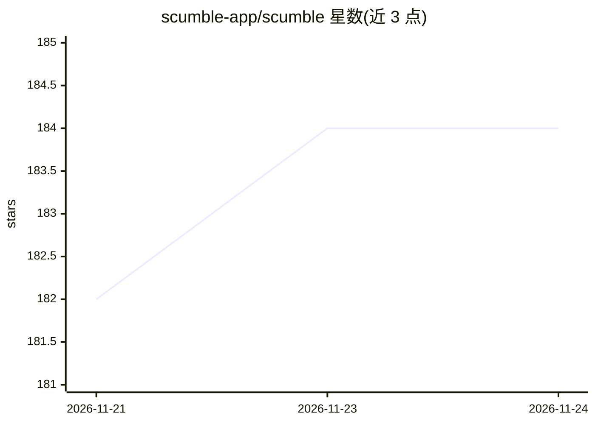

# scumble-app/scumble

⭐ 184 · JavaScript · GPL-3.0 · 推送 2026-11-20 · [GitHub](https://github.com/scumble-app/scumble) · [官网](https://scumble-app.github.io/scumble/) · 个人维护

**AI 图像局部重绘/生成桌面编辑器，结果以图层返回**

面向桌面端的图像编辑器，围绕 AI 模型组织：框选区域或空画布上画框并输入提示词，生成/重绘/放大结果作为独立图层返回并与周边色彩匹配，可继续遮罩、混合、加滤镜后导出。渲染走自己的 ComfyUI（本地或远程）、Comfy Cloud，或直接粘贴 Black Forest Labs、OpenAI、Google、fal.ai、Replicate、OpenRouter 等 API key；无任何后端时仍可绘画、分层、滤镜与导出，内置模型在本地下载后运行。全部命令暴露为 MCP server（124 个工具），支持 PSD/OpenRaster 图层导出。版本 0.1.x，作者自述部分功能未经端到端测试。

## 筛选速览

| 维度 | 判定 | 备注 |
|---|---|---|
| AI 角色 | `ai-native` | 本体是模型或模型工具 |
| 许可风险 | `viral` | GPL-3.0 |
| 部署形态 | `desktop` | 安装包/桌面程序 |
| 模型依赖 | locked-api |  |
| 硬件要求 | — | 无带数字的原话,不猜 |
| 安装摩擦 | `low` | 无编译、无系统依赖或容器化 |
| 成熟度 | `idea` | |

## 能力要点

- 每次 AI 结果都是独立图层，带 Match 滑杆做色彩匹配与独立撤销
- 渲染后端可选：自建 ComfyUI、Comfy Cloud 或多家 API key（无需 ComfyUI）
- 全部功能命令化为 MCP server，可被 Claude Desktop/Claude Code 等 MCP 客户端驱动
- PSD/OpenRaster 图层导出，Rust 瓦片引擎支持 15,000×10,000 像素文档

## 适用场景

- 在图片中框选区域做局部重绘并保留图层结构
- 用 API key 或本地 ComfyUI 生成完整图像，逐层叠加编辑
- 通过 MCP 让 agent 代为执行选区、生成与导出

## 场景标签

`图像生成` · 领域:内容生成

## 证据(README 行号)

> L36: Scumble is a desktop image editor built around AI models. Select part of a picture, or draw boxes on an empty
> L39: remote one), on Comfy Cloud, or through the API keys you may already have for FLUX, GPT Image, Nano Banana, Seedrea

## 星数曲线

2026-11-21 182 → 2026-11-24 184（+2）

---
*卡片 v1 · prompt 1.4 · 生成 2026-11-21 · 置信度 mid · 依据 README sha `6e98782f5adc` · [字段定义](../../DATASET.md)*
