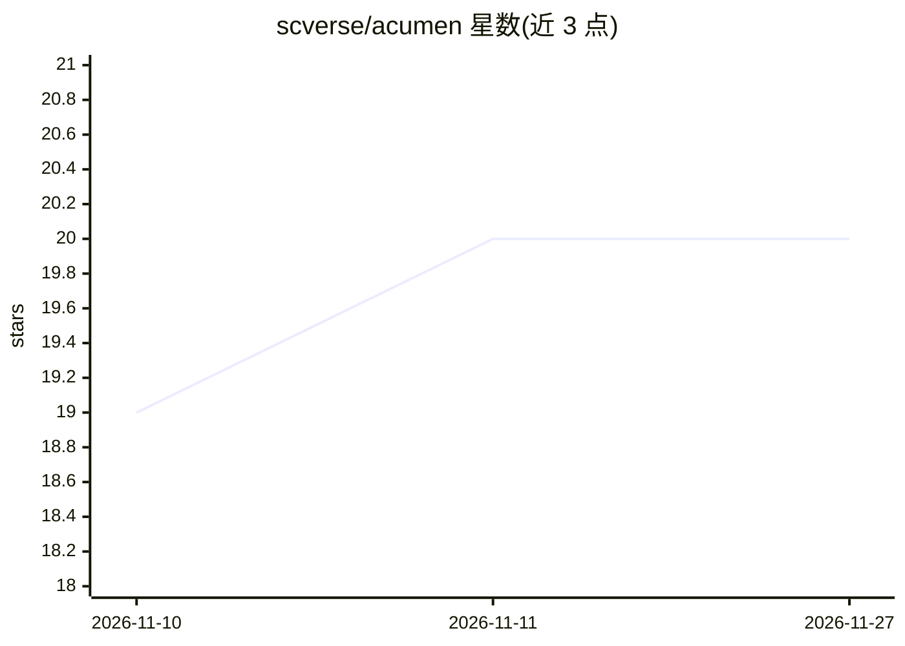

# scverse/acumen

⭐ 20 · Python · MIT · 推送 2026-11-24 · [GitHub](https://github.com/scverse/acumen) · [官网](https://acumen-skills.readthedocs.io/) · 组织维护

**为 Python 包训练和优化编码 agent 技能的工具包**

acumen 是一个 Python 包，用于为任意 Python 包构建、基准测试和优化 agentic skill——即帮助编码 agent 正确使用该包的简短纯文本指令集。给定包和若干任务，它以类似训练模型的方式迭代训练技能：每个 epoch 中编码 agent 尝试训练任务，acumen 根据其错误重写技能；新版本在留出的验证任务上评分，验证不再提升即停止，最佳版本最终在未触碰的测试集上评估。运行 agent 需要 Claude 或 Codex 后端及相应登录/API key，需 Python 3.12+。

## 筛选速览

| 维度 | 判定 | 备注 |
|---|---|---|
| AI 角色 | `ai-ecosystem` | LLM/agent 周边工具 |
| 许可风险 | `permissive` | MIT |
| 部署形态 | `library` | 以包/库形式分发 |
| 模型依赖 | — | README 未给出锁定关系 |
| 硬件要求 | — | 无带数字的原话,不猜 |
| 安装摩擦 | `low` | 无编译、无系统依赖或容器化 |
| 成熟度 | — | 结构信号不足 |

## 能力要点

- epoch 式技能训练：agent 尝试任务→从错误中重写技能
- 留出验证集评分与早停机制，最终在测试集上评估
- 支持 Claude 和 Codex 两种 agent 后端，可按需安装
- scverse 项目成员，受 NumFOCUS 财政资助

## 适用场景

- 为 Python 包编写让编码 agent 正确调用该包的技能
- 基准测试技能对不同任务求解成功率的影响
- 对比有无技能时 agent 使用某包完成任务的表现

## 场景标签

`模型评测` `提示工程` · 领域:Agent 开发

## 证据(README 行号)

> L16: `acumen` is a python package to build, benchmark and optimize agentic skills for any Python package.
> L18: Given a package and a few tasks, `acumen` trains a skill in the same way one would train a model.
> L43: `acumen` runs its agents with Claude, Codex, or both, and you only need to install the backend you use.

## 星数曲线

2026-11-10 19 → 2026-11-27 20（+1）

---
*卡片 v1 · prompt 1.4 · 生成 2026-11-18 · 置信度 high · 依据 README sha `6a6b3b97265b` · [字段定义](../../DATASET.md)*
