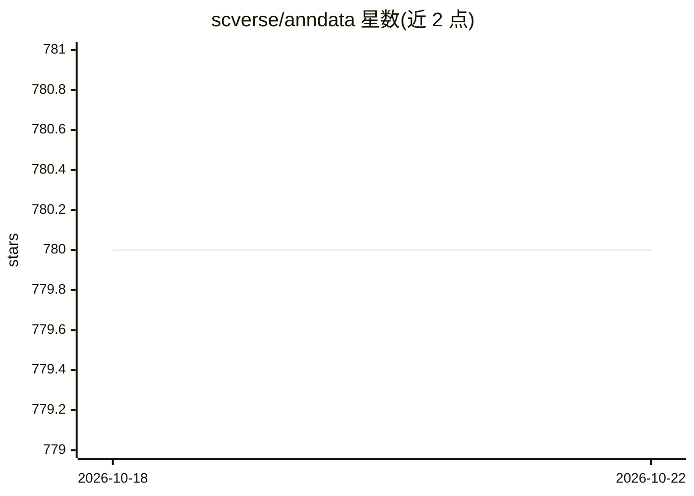

# scverse/anndata

⭐ 780 · Python · BSD-3-Clause · 推送 2026-10-21 · [GitHub](https://github.com/scverse/anndata) · [官网](http://anndata.scverse.org) · 组织维护

**处理带标注数据矩阵的 Python 包，面向单细胞组学分析**

anndata 是一个 Python 包，在内存和磁盘上处理带标注的数据矩阵，定位介于 pandas 与 xarray 之间，提供稀疏数据支持、惰性操作等计算效率特性。最初为 Scanpy 构建，是 scverse 单细胞组学生态的组成部分，由 NumFOCUS 财务赞助。配套的独立数据加载包 annbatch 提供 minibatch 加载，覆盖从线性模型到基础模型、从小型内存矩阵到 TB 级磁盘数据集的场景。有 JOSS 2024 论文可引用。

## 筛选速览

| 维度 | 判定 | 备注 |
|---|---|---|
| AI 角色 | `ai-ecosystem` | LLM/agent 周边工具 |
| 许可风险 | `permissive` | BSD-3-Clause |
| 部署形态 | `library` | 以包/库形式分发 |
| 模型依赖 | — | README 未给出锁定关系 |
| 硬件要求 | — | 无带数字的原话,不猜 |
| 安装摩擦 | `low` | 无编译、无系统依赖或容器化 |
| 成熟度 | — | 结构信号不足 |

## 能力要点

- 内存与磁盘上的带标注数据矩阵处理，支持稀疏数据与惰性操作
- 配套 annbatch 包提供面向基础模型的 minibatch 数据加载
- 为 Scanpy 构建，属于 scverse 项目生态

## 适用场景

- 单细胞组学分析中存放与读取带标注的表达矩阵
- 为机器学习/基础模型管线提供磁盘数据加载
- 在 pandas 与 xarray 之间需求的标注矩阵结构

## 场景标签

 · 领域:生物信息学/数据基础设施

## 证据(README 行号)

> L18: anndata is a Python package for handling annotated data matrices in memory and on disk, positioned between pandas a
> L19: A separate data loader package, annbatch, offers minibatch data loading functionality for applications ranging from
> L25: - See Scanpy's documentation for usage related to single cell data. anndata was initially built for Scanpy.

## 星数曲线

2026-10-18 780 → 2026-10-22 780（+0）

---
*卡片 v1 · prompt 1.4 · 生成 2026-10-21 · 置信度 mid · 依据 README sha `35897a54e53d` · [字段定义](../../DATASET.md)*
