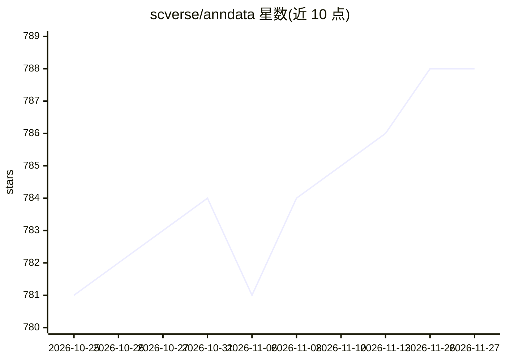

# scverse/anndata

⭐ 788 · Python · BSD-3-Clause · 推送 2026-11-26 · [GitHub](https://github.com/scverse/anndata) · [官网](http://anndata.scverse.org) · 组织维护

**单细胞组学带注释数据矩阵的 Python 存储与操作包**

Python 包，用于在内存和磁盘上处理带注释的数据矩阵，定位介于 pandas 与 xarray 之间，提供稀疏数据支持、惰性操作等计算特性；配套数据加载包 annbatch 提供从内存小矩阵到 TB 级磁盘数据集的小批量加载。原为 Scanpy 而构建，属 scverse 项目，由 NumFOCUS 财政赞助。通过 pip 或 conda 安装，公共 API 有文档，内部 API 不保证稳定。

## 筛选速览

| 维度 | 判定 | 备注 |
|---|---|---|
| AI 角色 | `ai-ecosystem` | LLM/agent 周边工具 |
| 许可风险 | `permissive` | BSD-3-Clause |
| 部署形态 | `library` | 以包/库形式分发 |
| 模型依赖 | — | README 未给出锁定关系 |
| 硬件要求 | — | 无带数字的原话,不猜 |
| 安装摩擦 | `low` | 无编译、无系统依赖或容器化 |
| 成熟度 | — | 结构信号不足 |

## 能力要点

- 内存与磁盘上的带注释数据矩阵处理
- 稀疏数据支持与惰性操作
- 配套 annbatch 数据加载包，支持小批量加载至 TB 级数据集
- 为 Scanpy 生态构建，scverse 项目成员

## 适用场景

- 存储与操作带注释的单细胞转录组数据矩阵
- 为线性模型到基础模型的应用批量加载数据
- 在 scverse 生态中配合 Scanpy 做单细胞分析

## 场景标签

 · 领域:生物信息学/数据科学基础设施

## 证据(README 行号)

> L18: anndata is a Python package for handling annotated data matrices in memory and on disk, positioned between pandas a
> L25: - See Scanpy's documentation for usage related to single cell data. anndata was initially built for Scanpy.
> L27: anndata is part of the scverse® project (website, governance) and is fiscally sponsored by NumFOCUS.

## 星数曲线

2026-10-25 781 → 2026-11-27 788（+7）

---
*卡片 v1 · prompt 1.4 · 生成 2026-11-24 · 置信度 high · 依据 README sha `ceac8f73b6b7` · [字段定义](../../DATASET.md)*
