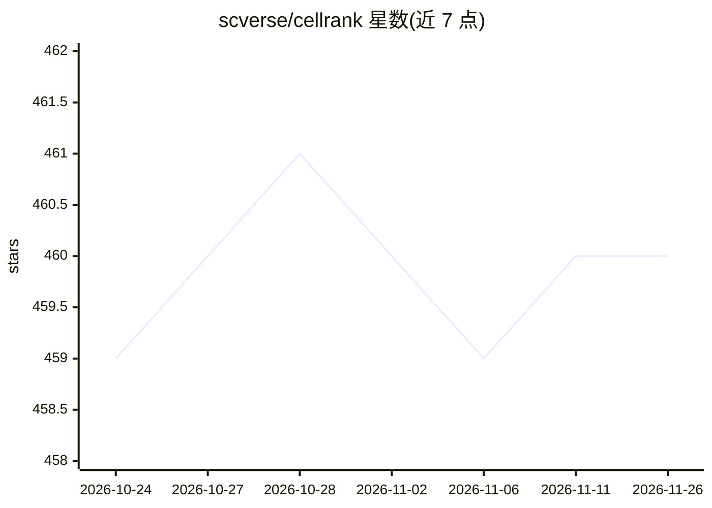

# scverse/cellrank

⭐ 460 · Python · BSD-3-Clause · 推送 2026-11-13 · [GitHub](https://github.com/scverse/cellrank) · [官网](https://cellrank.readthedocs.io/en/latest/) · 组织维护

**单细胞数据命运映射框架：基于马尔可夫状态建模推断细胞动态**

CellRank 2 是一个模块化框架，基于多视图单细胞数据的马尔可夫状态建模研究细胞动态，后端由 pyGPCCA 驱动。功能包括依据 RNA velocity、拟时序、实验时间点等生物先验估计分化方向，计算初始/终末/中间宏观状态，推断命运概率与驱动基因，以及可视化与聚类基因表达趋势。可扩展至大规模细胞数，与 scverse 生态完全兼容，通过 pip 安装。

## 筛选速览

| 维度 | 判定 | 备注 |
|---|---|---|
| AI 角色 | `ai-native` | 本体是模型或模型工具 |
| 许可风险 | `permissive` | BSD-3-Clause |
| 部署形态 | `library` | 以包/库形式分发 |
| 模型依赖 | — | README 未给出锁定关系 |
| 硬件要求 | — | 无带数字的原话,不猜 |
| 安装摩擦 | `low` | 无编译、无系统依赖或容器化 |
| 成熟度 | — | 结构信号不足 |

## 能力要点

- 基于马尔可夫状态建模的多视图单细胞命运映射
- 支持 RNA velocity、拟时序、实验时间点、代谢标记等多种生物先验
- 与 scverse 生态兼容，后端由 pyGPCCA 驱动
- 计算初始、终末与中间宏观状态并推断命运概率与驱动基因

## 适用场景

- 根据 RNA velocity 或拟时序推断细胞的分化方向与命运概率
- 识别干细胞性、终末与中间细胞状态
- 可视化并聚类基因表达趋势以发现驱动基因

## 场景标签

 · 领域:生命科学/生物信息学

## 证据(README 行号)

> L13: **CellRank** is a modular framework to study cellular dynamics based on Markov state modeling of
> L25: - Estimate differentiation direction based on a varied number of biological priors, including RNA velocity

## 星数曲线

2026-10-24 459 → 2026-11-26 460（+1）

---
*卡片 v1 · prompt 1.4 · 生成 2026-11-25 · 置信度 high · 依据 README sha `a4b14d791cf5` · [字段定义](../../DATASET.md)*
