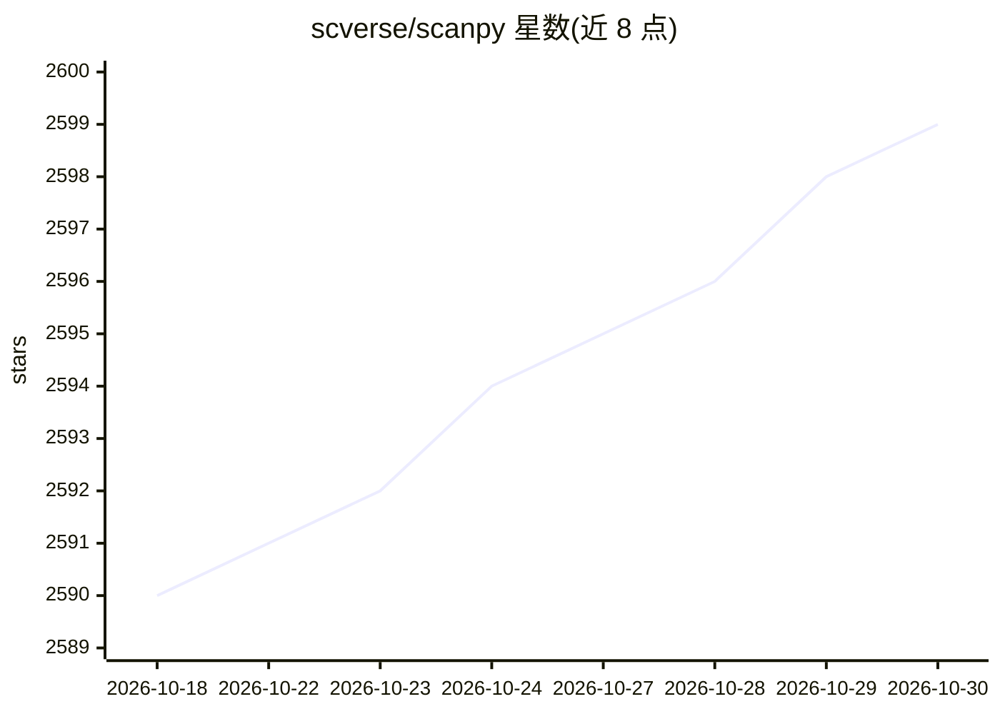

# scverse/scanpy

⭐ 2,599 · Python · BSD-3-Clause · 推送 2026-10-29 · [GitHub](https://github.com/scverse/scanpy) · [官网](https://scanpy.scverse.org) · 组织维护

**Python 单细胞基因表达数据分析工具包，可扩展至超百万细胞**

scverse 项目下的单细胞分析 Python 工具包，与 anndata 联合构建，提供预处理、可视化、聚类、轨迹推断和差异表达检验功能，Python 实现可高效处理超过一百万细胞的数据集；内存放不下的数据集可经 dask 兼容运行（官方标注为实验性）。面向生物信息学研究者与数据科学开发者，通过 PyPI 与 conda-forge 分发。内部 API 不保证稳定性，官方仅支持文档化的公共 API；使用需引用 Genome Biology 2018 论文。

## 筛选速览

| 维度 | 判定 | 备注 |
|---|---|---|
| AI 角色 | `ai-native` | 本体是模型或模型工具 |
| 许可风险 | `permissive` | BSD-3-Clause |
| 部署形态 | `library` | 以包/库形式分发 |
| 模型依赖 | — | README 未给出锁定关系 |
| 硬件要求 | — | 无带数字的原话,不猜 |
| 安装摩擦 | `low` | 无编译、无系统依赖或容器化 |
| 成熟度 | `idea` | |

## 能力要点

- 提供单细胞预处理、可视化、聚类、轨迹推断与差异表达检验
- Python 实现可处理超过一百万细胞的数据集
- 超内存数据集可配合 dask 使用（实验性）
- 与 anndata 联合构建，属 scverse 生态系统

## 适用场景

- 对单细胞转录组数据做端到端分析流程
- 在超大规模（>1M 细胞）数据集上执行聚类与差异表达
- 结合 scverse 生态其他工具构建组学分析管线

## 场景标签

`数据分析` · 领域:效率与自动化

## 证据(README 行号)

> L14: Scanpy is a scalable toolkit for analyzing single-cell gene expression data built jointly with [anndata][].
> L15: It includes preprocessing, visualization, clustering, trajectory inference and differential expression testing.

## 星数曲线

2026-10-18 2,590 → 2026-10-30 2,599（+9）

---
*卡片 v1 · prompt 1.4 · 生成 2026-10-21 · 置信度 high · 依据 README sha `af4114ddada6` · [字段定义](../../DATASET.md)*
