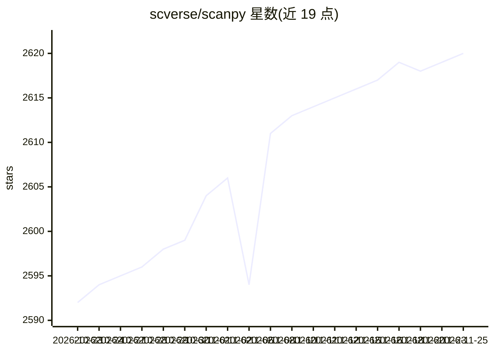

# scverse/scanpy

⭐ 2,620 · Python · BSD-3-Clause · 推送 2026-11-23 · [GitHub](https://github.com/scverse/scanpy) · [官网](https://scanpy.scverse.org) · 组织维护

**单细胞转录组数据的 Python 分析工具包**

Scanpy 是与 anndata 联合构建的可扩展单细胞基因表达数据分析工具包，功能覆盖预处理、可视化、聚类、轨迹推断与差异表达检验。Python 实现可处理超过一百万细胞的数据集；对于超出内存的大数据集，多数函数兼容 dask 后端（标注为实验性）。项目属于 scverse 生态，受 NumFOCUS 财政资助，通过 PyPI 与 Conda Forge 分发，公共 API 有文档说明，内部 API 不保证稳定性。

## 筛选速览

| 维度 | 判定 | 备注 |
|---|---|---|
| AI 角色 | `ai-native` | 本体是模型或模型工具 |
| 许可风险 | `permissive` | BSD-3-Clause |
| 部署形态 | `library` | 以包/库形式分发 |
| 模型依赖 | — | README 未给出锁定关系 |
| 硬件要求 | — | 无带数字的原话,不猜 |
| 安装摩擦 | `low` | 无编译、无系统依赖或容器化 |
| 成熟度 | — | 结构信号不足 |

## 能力要点

- 预处理、可视化、聚类、轨迹推断、差异表达检验功能集
- 基于 anndata 数据结构，可处理超百万细胞数据集
- 大内存外数据集兼容 dask 后端（实验性）
- 提供公开 API 文档与引用文献（Genome Biology 2018）

## 适用场景

- 对单细胞基因表达数据做预处理与聚类分析
- 构建细胞轨迹推断与分化路径分析流程
- 可视化单细胞数据并进行差异表达检验

## 场景标签

`科研工具` · 领域:学习与行业

## 证据(README 行号)

> L14: Scanpy is a scalable toolkit for analyzing single-cell gene expression data built jointly with [anndata][].
> L15: It includes preprocessing, visualization, clustering, trajectory inference and differential expression testing.
> L16: The Python-based implementation efficiently deals with datasets of more than one million cells.

## 星数曲线

2026-10-23 2,592 → 2026-11-25 2,620（+28）

---
*卡片 v1 · prompt 1.4 · 生成 2026-11-24 · 置信度 high · 依据 README sha `0cf1e31e80ba` · [字段定义](../../DATASET.md)*
