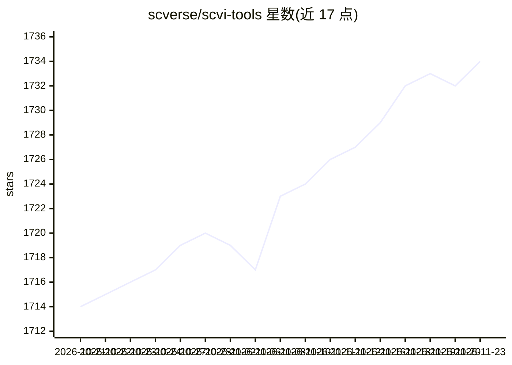

# scverse/scvi-tools

⭐ 1,734 · Python · BSD-3-Clause · 推送 2026-11-19 · [GitHub](https://github.com/scverse/scvi-tools) · [官网](http://scvi-tools.org/) · 组织维护

**单细胞与空间组学数据的深度概率建模分析库**

scvi-tools（single-cell variational inference tools）是基于 PyTorch 与 AnnData 的概率建模分析包，面向单细胞、多组学与空间组学数据，提供降维、数据整合、自动注释、因子分析、双联体检测、空间去卷积等任务的模型实现，模型高层 API 与 Scanpy 交互并支持保存/加载与 GPU 加速；同时提供基于 PyTorch Lightning 与 Pyro 的构建模块和骨架仓库，用于开发部署新的概率模型。通过 conda 或 pip 安装，文档含教程与 API 参考，属 scverse 生态项目并由 NumFOCUS 赞助。

## 筛选速览

| 维度 | 判定 | 备注 |
|---|---|---|
| AI 角色 | `ai-native` | 本体是模型或模型工具 |
| 许可风险 | `permissive` | BSD-3-Clause |
| 部署形态 | `library` | 以包/库形式分发 |
| 模型依赖 | — | README 未给出锁定关系 |
| 硬件要求 | — | 无带数字的原话,不猜 |
| 安装摩擦 | `low` | 无编译、无系统依赖或容器化 |
| 成熟度 | — | 结构信号不足 |

## 能力要点

- 覆盖单细胞/多组学/空间组学的模型集：降维、整合、注释、双联体检测、空间去卷积等
- 高层 API 与 Scanpy 交互，含标准 save/load 与 GPU 加速
- 提供 PyTorch Lightning/Pyro 驱动的构建块与 skeleton repository 用于开发新概率模型
- conda 与 pip 双安装途径，附用户指南、论坛与教程

## 适用场景

- 对单细胞 RNA 测序数据做批次整合与降维
- 对 CITE-seq 等多组学数据做自动细胞注释
- 对空间转录组数据做细胞类型去卷积
- 基于其构建块开发新的概率模型

## 场景标签

`科研工具` · 领域:学习与行业

## 证据(README 行号)

> L18: [scvi-tools] (single-cell variational inference tools) is a package for probabilistic modeling and
> L23: scvi-tools is composed of models that perform many analysis tasks across single-cell, multi, and
> L35: high-level API that interacts with [Scanpy] and includes standard save/load functions, GPU

## 星数曲线

2026-10-21 1,714 → 2026-11-23 1,734（+20）

---
*卡片 v1 · prompt 1.4 · 生成 2026-11-23 · 置信度 high · 依据 README sha `861008ee7e8a` · [字段定义](../../DATASET.md)*
