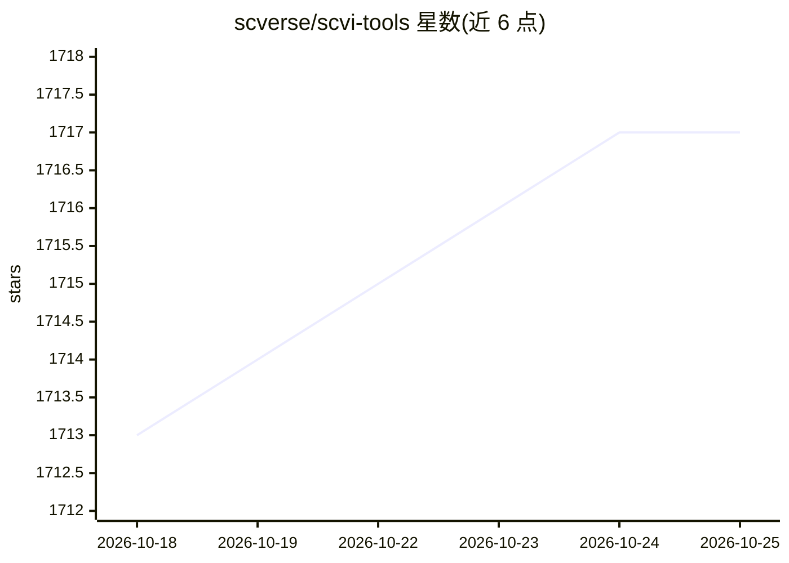

# scverse/scvi-tools

⭐ 1,717 · Python · BSD-3-Clause · 推送 2026-10-22 · [GitHub](https://github.com/scverse/scvi-tools) · [官网](http://scvi-tools.org/) · 组织维护

**单细胞组学数据的概率建模与分析 Python 库**

scvi-tools 是基于 PyTorch 与 AnnData 构建的概率建模分析包，面向单细胞、多组学与空间组学数据，提供降维、数据整合、自动注释、因子分析、双联体检测、空间去卷积等模型，高层 API 与 Scanpy 交互并支持 GPU 加速与保存/加载。同时包含基于 PyTorch Lightning 与 Pyro 的构建模块，用于开发新的概率模型。以 conda 与 pip 安装，属 scverse 项目，由 NumFOCUS 赞助。

## 筛选速览

| 维度 | 判定 | 备注 |
|---|---|---|
| AI 角色 | `ai-native` | 本体是模型或模型工具 |
| 许可风险 | `permissive` | BSD-3-Clause |
| 部署形态 | `library` | 以包/库形式分发 |
| 模型依赖 | — | README 未给出锁定关系 |
| 硬件要求 | — | 无带数字的原话,不猜 |
| 安装摩擦 | `low` | 无编译、无系统依赖或容器化 |
| 成熟度 | — | 结构信号不足 |

## 能力要点

- 覆盖降维、整合、自动注释、双联体检测、空间去卷积等分析模型
- 高层 API 与 Scanpy 交互，支持 GPU 加速
- 提供基于 PyTorch Lightning 与 Pyro 的新模型开发构建模块

## 适用场景

- 对单细胞/空间转录组数据做概率建模分析
- 整合多批次单细胞数据或做细胞自动注释
- 基于其构建模块开发新的概率模型

## 场景标签

 · 领域:生物信息学/单细胞组学

## 证据(README 行号)

> L18: [scvi-tools] (single-cell variational inference tools) is a package for probabilistic modeling and
> L23: scvi-tools is composed of models that perform many analysis tasks across single-cell, multi, and
> L26: - Dimensionality reduction

## 星数曲线

2026-10-18 1,713 → 2026-10-25 1,717（+4）

---
*卡片 v1 · prompt 1.4 · 生成 2026-10-21 · 置信度 high · 依据 README sha `fd27f6216bf6` · [字段定义](../../DATASET.md)*
