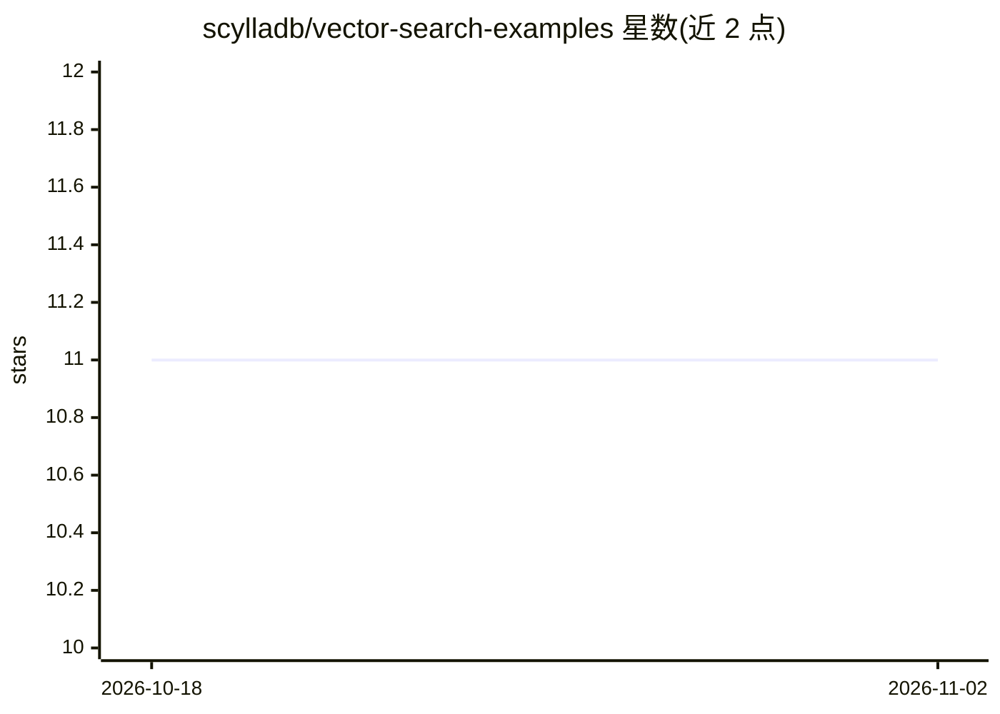

# scylladb/vector-search-examples

⭐ 11 · Python · Apache-2.0 · 推送 2026-10-26 · [GitHub](https://github.com/scylladb/vector-search-examples) · [官网](https://vector-search.scylladb.com) · 组织维护

**ScyllaDB 向量搜索示例应用集：演示向量检索与 RAG 搭建**

由 ScyllaDB 维护的示例应用仓库，演示如何用 ScyllaDB 实现向量搜索用例及更复杂的 LLM 应用：包含向量搜索应用、RAG 聊天机器人、语义缓存层、mem0 记忆集成四类示例的构建方式，并链接 ScyllaDB Cloud、官方文档与分步教程等资源。面向希望在 NoSQL 数据库上搭建向量检索与 RAG 管线的开发者，属于教学示范性质，非可直接安装运行的产品。

## 筛选速览

| 维度 | 判定 | 备注 |
|---|---|---|
| AI 角色 | `ai-knowledge` | 知识聚合/清单类 |
| 许可风险 | `permissive` | Apache-2.0 |
| 部署形态 | `None` |  |
| 模型依赖 | — | README 未给出锁定关系 |
| 硬件要求 | — | 无带数字的原话,不猜 |
| 安装摩擦 | `low` | 无编译、无系统依赖或容器化 |
| 成熟度 | — | 结构信号不足 |

## 能力要点

- 覆盖向量搜索、RAG 聊天机器人、语义缓存三类示例
- 提供 mem0 记忆集成示例
- 附 ScyllaDB 官方文档与分步教程链接

## 适用场景

- 学习如何在 ScyllaDB 上构建向量搜索应用
- 参考示例搭建 RAG 聊天机器人或语义缓存层
- 了解 mem0 记忆系统与 ScyllaDB 的集成方式

## 场景标签

 · 领域:数据库/LLM 应用示例

## 证据(README 行号)

> L3: This repository contains sample applications demonstrating
> L5: more complex LLM apps such as retrieval-augmented generation

## 星数曲线

2026-10-18 11 → 2026-11-02 11（+0）

---
*卡片 v1 · prompt 1.4 · 生成 2026-11-02 · 置信度 high · 依据 README sha `ba194897078a` · [字段定义](../../DATASET.md)*
