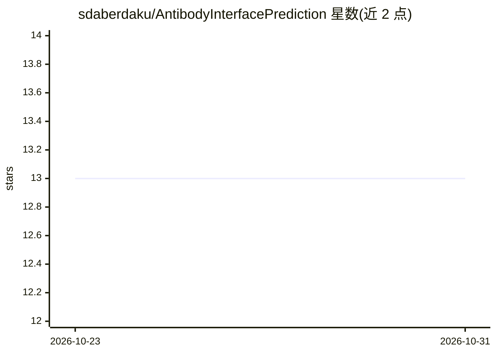

# sdaberdaku/AntibodyInterfacePrediction

⭐ 13 · C++ · BSD-3-Clause · 推送 2026-10-21 · [GitHub](https://github.com/sdaberdaku/AntibodyInterfacePrediction) · 个人维护

**预测抗体-抗原界面的 3D Zernike 描述符 + SVM 软件**

论文配套软件，用 3D Zernike 表面描述符与 SVM 预测抗体-抗原界面（paratope）：提供 train/test 预编译可执行文件与 single_structure_descriptors，读取 PDB 文件，依赖 CHARMM22 原子半径文件做表面计算。C++ 源码需 g++（OpenMP）与多个 Boost 库编译，Makefile 静态链接且 -march=native 编译；另含 Python 2.7 脚本（需旧版 scikit-learn）。BSD 3-Clause 许可。

## 筛选速览

| 维度 | 判定 | 备注 |
|---|---|---|
| AI 角色 | `ai-native` | 本体是模型或模型工具 |
| 许可风险 | `permissive` | BSD-3-Clause |
| 部署形态 | `None` |  |
| 模型依赖 | — | README 未给出锁定关系 |
| 硬件要求 | — | 无带数字的原话,不猜 |
| 安装摩擦 | `medium` | 含编译或系统依赖之一 |
| 成熟度 | — | 结构信号不足 |

## 能力要点

- train/test 可执行文件从 PDB 输入预测抗体界面
- 3D Zernike 表面描述符 + SVM 方法
- 可用 --atom_radii 自定义原子半径文件
- 提供源码编译路径（g++/OpenMP/Boost）

## 适用场景

- 从抗体-抗原 PDB 结构预测界面残基
- 生成 3D Zernike 描述符用于训练或复现论文
- 复现 Bioinformatics 2019 论文实验流程

## 场景标签

 · 领域:生物信息学/蛋白质结构预测

## 证据(README 行号)

> L5: Daberdaku S, Ferrari C. Antibody interface prediction with 3D Zernike descriptors and SVM. Bioinformatics 35(11),
> L21: ./train --receptor antibody.pdb --ligand antigen.pdb

## 星数曲线

2026-10-23 13 → 2026-10-31 13（+0）

---
*卡片 v1 · prompt 1.4 · 生成 2026-10-31 · 置信度 high · 依据 README sha `465f1c08b90a` · [字段定义](../../DATASET.md)*
