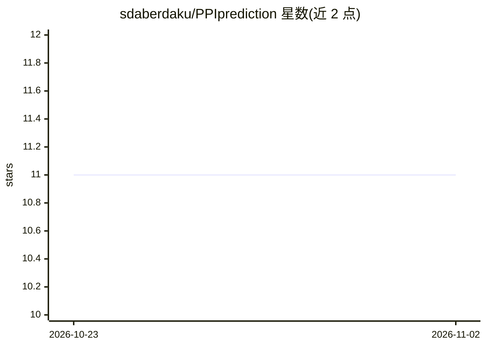

# sdaberdaku/PPIprediction

⭐ 11 · C++ · BSD-3-Clause · 推送 2026-10-21 · [GitHub](https://github.com/sdaberdaku/PPIprediction) · 个人维护

**用 3D Zernike 描述子与 SVM 预测蛋白质-蛋白质界面的软件**

论文配套软件，包含 C++ 可执行程序 train 与 test：读取受体与配体 PDB 文件，基于 CHARMM22 原子半径计算表面并提取 3D Zernike 表面描述子，用于生成训练样本和预测蛋白质-蛋白质界面。源码需 g++（OpenMP 支持）与多个 Boost 库编译，静态链接并使用 -march=native。另含 Python 2.7 脚本，依赖旧版 scikit-learn，数据集路径需手工修改。BSD 3-Clause 许可。

## 筛选速览

| 维度 | 判定 | 备注 |
|---|---|---|
| AI 角色 | `ai-native` | 本体是模型或模型工具 |
| 许可风险 | `permissive` | BSD-3-Clause |
| 部署形态 | `None` |  |
| 模型依赖 | — | README 未给出锁定关系 |
| 硬件要求 | — | 无带数字的原话,不猜 |
| 安装摩擦 | `medium` | 含编译或系统依赖之一 |
| 成熟度 | — | 结构信号不足 |

## 能力要点

- train/test 可执行程序读取 PDB 文件生成界面预测
- 表面计算使用 CHARMM22 原子半径文件（可自定义）
- Python 脚本用于 NumPy/SciPy/scikit-learn 处理流程
- GCC 13 与 Boost 1.83 在 Ubuntu 24.04 上测试通过

## 适用场景

- 复现论文中的蛋白质-蛋白质界面预测结果
- 基于自选 PDB 结构生成界面预测输入
- 在我的蛋白质复合物数据上训练与测试界面预测器

## 场景标签

 · 领域:生物信息学/结构生物学

## 证据(README 行号)

> L5: Daberdaku S, Ferrari C. Exploring the potential of 3D Zernike descriptors and SVM for protein–protein interface
> L6: prediction. BMC Bioinformatics 19, 35 (2018). https://doi.org/10.1186/s12859-018-2043-3
> L22: ./train --receptor receptor.pdb --ligand ligand.pdb
> L23: ./test --receptor receptor.pdb --ligand ligand.pdb

## 星数曲线

2026-10-23 11 → 2026-11-02 11（+0）

---
*卡片 v1 · prompt 1.4 · 生成 2026-11-02 · 置信度 high · 依据 README sha `48d55790a5d0` · [字段定义](../../DATASET.md)*
