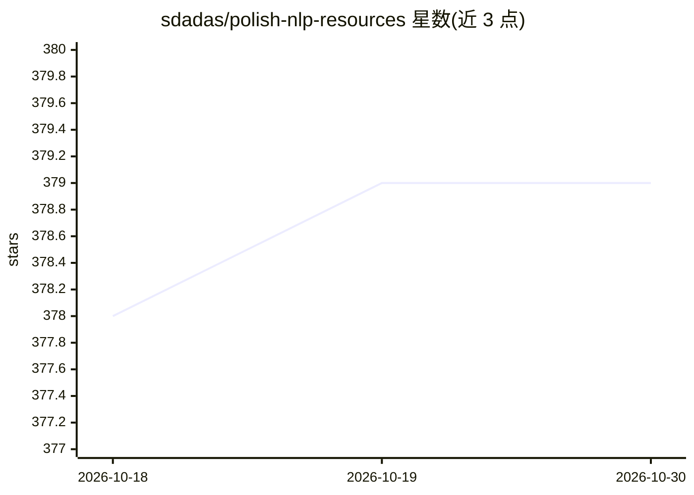

# sdadas/polish-nlp-resources

⭐ 379 · LGPL-3.0 · 推送 2026-03-02 · [GitHub](https://github.com/sdadas/polish-nlp-resources) · 个人维护

**波兰语 NLP 预训练模型与语言资源合集**

作者在研究期间训练并发布的波兰语 NLP 资源仓库，部分模型同步发布于 Huggingface Hub。内容包括：15 亿 token 语料训练的 Word2Vec/FastText/GloVe 词向量（100-800 维）、压缩版 Word2Vec（38MB）、Wikipedia2Vec 实体向量、ELMo、RoBERTa（base/large/v2/Distil）、BART、GPT-2（最长 2048 token 上下文）、Longformer，以及基于 Sentence-Transformers 蒸馏的 MMLW 文本编码器（含检索微调版）。各条目附 Python 用法示例与 Fairseq/Transformers 格式下载链接，研究使用需引用 BibTeX。

## 筛选速览

| 维度 | 判定 | 备注 |
|---|---|---|
| AI 角色 | `ai-knowledge` | 知识聚合/清单类 |
| 许可风险 | `viral` | LGPL-3.0 |
| 部署形态 | `None` |  |
| 模型依赖 | — | README 未给出锁定关系 |
| 硬件要求 | — | 无带数字的原话,不猜 |
| 安装摩擦 | `low` | 无编译、无系统依赖或容器化 |
| 成熟度 | — | 结构信号不足 |

## 能力要点

- 词向量（Word2Vec/FastText/GloVe/Wikipedia2Vec，100-800 维）与压缩版（38MB，原版 4.4%）
- 波兰语 RoBERTa/BART/GPT-2/Longformer 权重，提供 Fairseq 与 HuggingFace Transformers 两种格式
- GPT-2 系列支持 2048 token 长上下文（小/中型号）
- MMLW 共 10 个文本编码器（蒸馏版与检索微调版），附 PL-MTEB 与 PIRB 得分

## 适用场景

- 波兰语文本任务选用预训练语言模型与词向量
- 波兰语语义检索、文本相似度与文档聚类选编码器
- 存储受限设备上部署压缩版波兰语词向量

## 场景标签

`精选清单` · 领域:学习与行业

## 证据(README 行号)

> L3: This repository contains pre-trained models and language resources for Natural Language Processing in Polish created
> L14: ## Contents

## 星数曲线

2026-10-18 378 → 2026-10-30 379（+1）

---
*卡片 v1 · prompt 1.4 · 生成 2026-10-21 · 置信度 high · 依据 README sha `e7d9ef60d342` · [字段定义](../../DATASET.md)*
