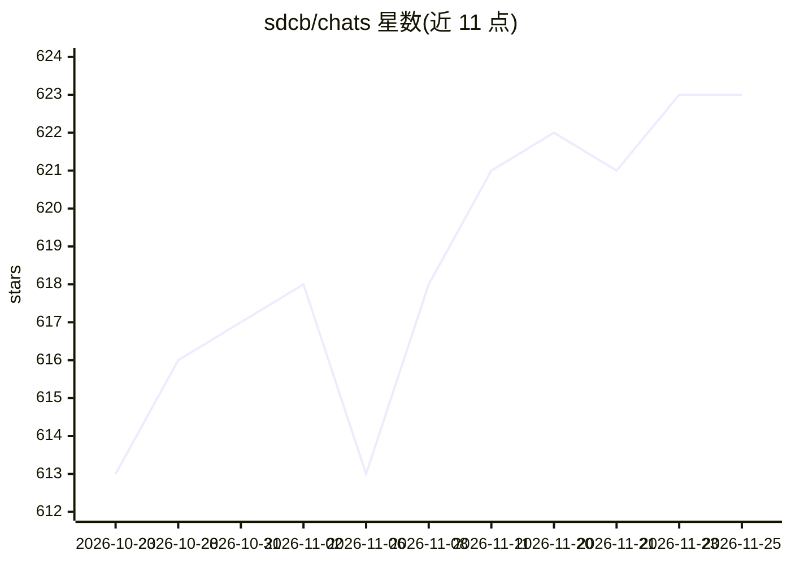

# sdcb/chats

⭐ 623 · C# · Apache-2.0 · 推送 2026-11-22 · [GitHub](https://github.com/sdcb/chats) · [官网](https://sdcb.ai/chats) · 个人维护 · 中文 README

**给开发者的 LLM 前端与 API 网关，统一接入 22+ 模型服务商**

以 .NET/TypeScript 开发的大语言模型前端与网关，将 22+ 主流模型服务商聚合为单一入口。提供 Chat Completions/Messages/Responses/Gemini 等协议兼容的 API 网关能力、Docker 沙箱代码解释器、请求全链路追踪、多模态视觉输入与图像生成；存储支持 SQLite/SQL Server/PostgreSQL 及本地/S3/OSS/Azure Blob，含用户权限、余额控制、限流审计与 Keycloak SSO。一条 Docker 命令部署，另提供 8 平台可执行文件。

## 筛选速览

| 维度 | 判定 | 备注 |
|---|---|---|
| AI 角色 | `ai-ecosystem` | LLM/agent 周边工具 |
| 许可风险 | `permissive` | Apache-2.0 |
| 部署形态 | `self-host` | docker 或自建部署 |
| 模型依赖 | — | README 未给出锁定关系 |
| 硬件要求 | — | 无带数字的原话,不猜 |
| 安装摩擦 | `low` | 无编译、无系统依赖或容器化 |
| 成熟度 | — | 结构信号不足 |

## 能力要点

- 兼容 Chat Completions/Messages/Responses/Gemini 协议的 API 网关
- Docker 沙箱代码解释器，内置浏览器/代码执行/Excel 工具
- Request Trace 全链路追踪与多模态视觉输入、图像生成
- SQLite/SQL Server/PostgreSQL 存储与 S3/OSS/Azure Blob 后端

## 适用场景

- 统一管理多家模型服务商的接口与密钥
- 为团队部署带权限和余额控制的内部 LLM 网关
- 让 Claude Code 等工具通过兼容 API 接入

## 场景标签

`模型网关` `聊天机器人` · 领域:Agent 开发

## 证据(README 行号)

> L12: - 🔌 **API 网关**：Chat Completions/Messages 兼容，支持 Claude Code
> L16: - 💾 **灵活存储**：SQLite/SQL Server/PostgreSQL + 本地/AWS S3/Aliyun OSS/Azure Blob
> L51: - 🤖 支持的模型提供商 - 22+ 模型服务商列表及支持情况

## 星数曲线

2026-10-23 613 → 2026-11-25 623（+10）

---
*卡片 v1 · prompt 1.4 · 生成 2026-11-24 · 置信度 high · 依据 README sha `046c6921e596` · [字段定义](../../DATASET.md)*
