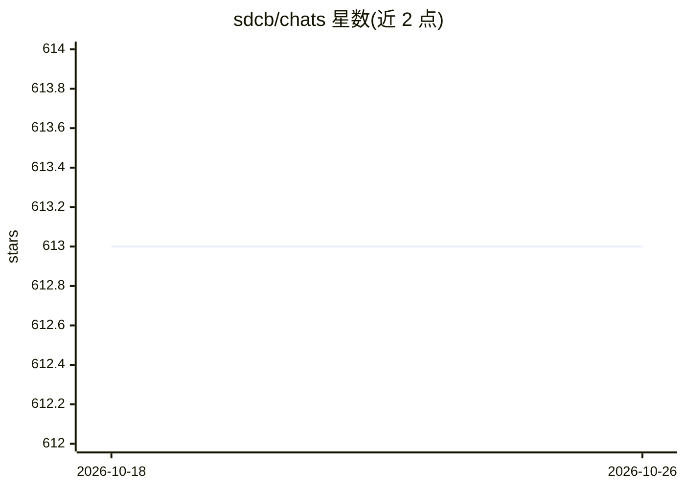

# sdcb/chats

⭐ 613 · C# · Apache-2.0 · 推送 2026-10-12 · [GitHub](https://github.com/sdcb/chats) · [官网](https://sdcb.ai/chats) · 个人维护 · 中文 README

**支持 22+ 模型服务商的 LLM 前端与 API 网关**

用 C#/TypeScript 开发的大语言模型前端与网关：统一接入 22+ 模型服务商，提供 Chat Completions/Messages/Responses/Gemini 标准协议、兼容 Claude Code 的 API 网关、Docker 沙箱代码解释器、多模态与图像生成、Request Trace 全链路追踪。存储支持 SQLite/SQL Server/PostgreSQL 及多种对象存储，含用户权限、余额控制、Keycloak SSO。一条 Docker 命令可启动，另有 8 平台原生可执行文件。

## 筛选速览

| 维度 | 判定 | 备注 |
|---|---|---|
| AI 角色 | `ai-ecosystem` | LLM/agent 周边工具 |
| 许可风险 | `permissive` | Apache-2.0 |
| 部署形态 | `self-host` | docker 或自建部署 |
| 模型依赖 | locked-api |  |
| 硬件要求 | — | 无带数字的原话,不猜 |
| 安装摩擦 | `low` | 无编译、无系统依赖或容器化 |
| 成熟度 | — | 结构信号不足 |

## 能力要点

- 22+ 模型服务商统一入口，一条 Docker 命令部署
- API 网关兼容 Chat Completions/Messages/Responses/Gemini，支持 Claude Code
- Docker 沙箱代码解释器，内置浏览器/代码执行/Excel 工具
- SQLite/SQL Server/PostgreSQL 存储，用户权限与限流审计、Keycloak SSO

## 适用场景

- 统一管理多种大模型接口并对外提供标准协议网关
- 团队内部署带权限管理和用量控制的自有聊天前端
- 需要 Claude Code 接入自有网关的场景

## 场景标签

`模型网关` `聊天机器人` · 领域:Agent 开发

## 证据(README 行号)

> L5: Sdcb Chats 是一个强大且灵活的大语言模型前端，支持 22+ 主流 AI 模型服务商。无论您是希望统一管理多种模型接口，还是需要一个简单易用的部署方案，Sdcb Chats 都能满足您的需求。
> L12: - 🔌 **API 网关**：Chat Completions/Messages 兼容，支持 Claude Code

## 星数曲线

2026-10-18 613 → 2026-10-26 613（+0）

---
*卡片 v1 · prompt 1.4 · 生成 2026-10-21 · 置信度 high · 依据 README sha `bf973f593904` · [字段定义](../../DATASET.md)*
