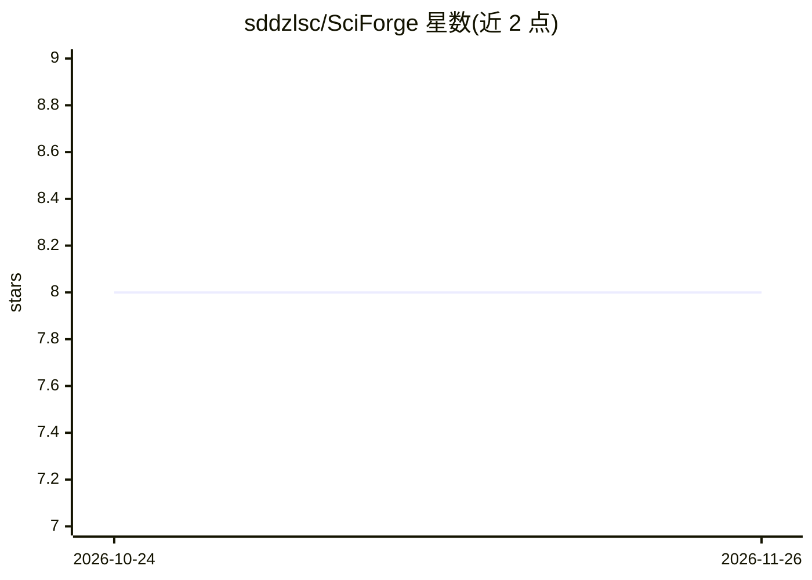

# sddzlsc/SciForge

⭐ 8 · Python · MIT · 推送 2026-10-18 · [GitHub](https://github.com/sddzlsc/SciForge) · 个人维护 · 中文 README

**面向深度学习科研者的本地研究 agent 工具：文献到论文全流程**

SciForge 将深度学习研究流程拆为可组合模块：46 个确定性工具、24 个研究技能、7 条 recipe 流水线与本地 Web 控制台，覆盖文献检索（arXiv/PubMed/OpenAlex 等免费源）、精读笔记、选题挖掘、SSH 远程 GPU 实验（tmux/Slurm、日志与指标采集）、LaTeX 论文写作与出版级图表生成。默认用 DeepSeek 并支持任意 OpenAI 兼容 LLM；本地监听 127.0.0.1，API key 不出机器。仅用合法 OA 全文，不接入 Sci-Hub。

## 筛选速览

| 维度 | 判定 | 备注 |
|---|---|---|
| AI 角色 | `ai-ecosystem` | LLM/agent 周边工具 |
| 许可风险 | `permissive` | MIT |
| 部署形态 | `library` | 以包/库形式分发 |
| 模型依赖 | locked-api |  |
| 硬件要求 | — | 无带数字的原话,不猜 |
| 安装摩擦 | `low` | 无编译、无系统依赖或容器化 |
| 成熟度 | `idea` | |

## 能力要点

- 13 阶段 full 流水线：survey→read→ideate→GPU 实验→分析→论文→图表，阶段可暂停/恢复
- 内置 SSH/tmux/Slurm 远程 GPU 编排，记录命令、seed、git commit 与指标
- 46 个工具调用全程可审计；写作时对 results/ 文件校验数字以防幻觉
- 声明式 DSL 生成会议风格架构图、曲线与 booktabs 表格（SVG/PDF）

## 适用场景

- 端到端跑完文献综述到论文初稿的研究流程
- 在远程 GPU 服务器上设计、启动并追踪训练实验
- 批量检索与精读 arXiv/PubMed 论文并生成对比笔记
- 从规格文件可复现地生成出版级图表

## 场景标签

`科研工具` · 领域:学习与行业

## 证据(README 行号)

> L13: **Skills** (research methodology) + **Tools** (46 deterministic capabilities) +
> L15: it runs the actual research loop — search, read, ideate, train on your GPU box, write, and draw
> L45: |🖥️ Web console|Local GUI: streaming chat (Markdown + offline KaTeX math), **in-chat pipeline with expandable stage

## 星数曲线

2026-10-24 8 → 2026-11-26 8（+0）

---
*卡片 v1 · prompt 1.4 · 生成 2026-11-20 · 置信度 high · 依据 README sha `d72b58bd47be` · [字段定义](../../DATASET.md)*
