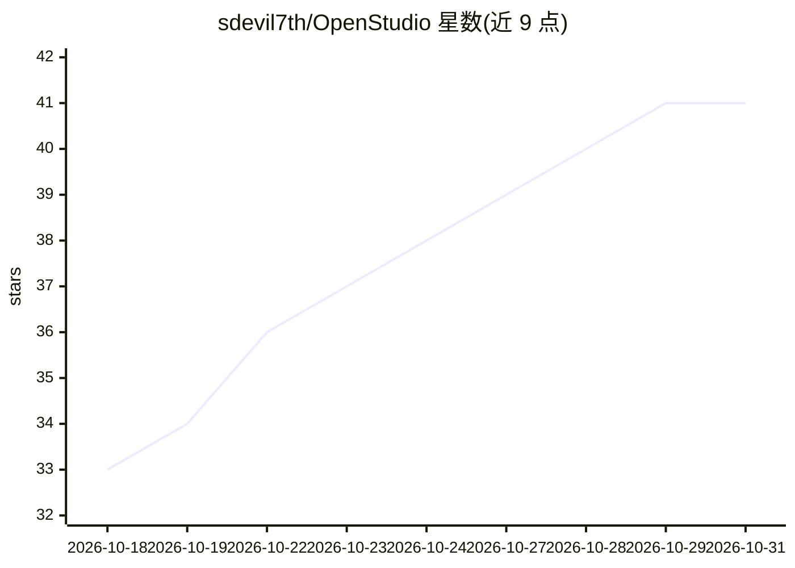

# sdevil7th/OpenStudio

⭐ 41 · C++ · AGPL-3.0 · 推送 2026-10-26 · [GitHub](https://github.com/sdevil7th/OpenStudio) · [官网](https://openstudio.org.in) · 个人维护

**开源本地优先的 DAW，内置可选本地 AI 音乐工具**

基于 JUCE/React 的原生桌面 DAW，面向 Windows/macOS/Linux，提供多轨录音、剪辑、混音、VST3/CLAP/LV2 插件宿主、图形化音高编辑、Lua 脚本与 NAM A1/A2 吉他机架。AI 为可选工具层：本地人声分离、ACE-Step/MiniMax Music 3/Stable Audio 生成与变体、audio-to-MIDI（Basic Pitch 小模型已内置）。大型生成模型为可选下载，FFmpeg 相关操作在 macOS/Linux 需系统 FFmpeg。基础应用按 AGPLv3 发布，无付费轨道数限制。

## 筛选速览

| 维度 | 判定 | 备注 |
|---|---|---|
| AI 角色 | `ai-enhanced` | 去掉 AI 部分产品仍成立 |
| 许可风险 | `dual` | AGPL-3.0 |
| 部署形态 | `None` |  |
| 模型依赖 | — | README 未给出锁定关系 |
| 硬件要求 | — | 无带数字的原话,不猜 |
| 安装摩擦 | `high` | 编译与系统依赖俱全 |
| 成熟度 | `idea` | |

## 能力要点

- 多轨录音/剪辑/混音/插件宿主的完整 DAW 功能，本地工程文件
- NAM A1/A2 放大器捕获机架、踏板、箱体 IR 免费内置
- 可选本地 AI 工具：stem 分离、文本生成音频、audio-to-MIDI、变体与续写
- Lua 脚本 API、JSFX 脚本效果、19 套 DAW 键盘方案

## 适用场景

- 在本地完成录音、编辑、混音到出品的完整流程
- 吉他/贝斯玩家免费使用 NAM 捕获与效果链
- 在 DAW 内用本地 AI 生成、变体、分离音频素材

## 场景标签

 · 领域:音乐制作/桌面音频软件

## 证据(README 行号)

> L5:  The open-source local-first DAW + AI music production alternative.
> L64: |AI|Optional AI Tools runtime, stem separation, ACE-Step music generation, MiniMax Music 3 lyrics/section-based son
> L43: OpenStudio is for people who want a real DAW surface, not just a prompt box: record or import material, edit it dee

## 星数曲线

2026-10-18 33 → 2026-10-31 41（+8）

---
*卡片 v1 · prompt 1.4 · 生成 2026-10-25 · 置信度 high · 依据 README sha `36c28a9d3fd8` · [字段定义](../../DATASET.md)*
