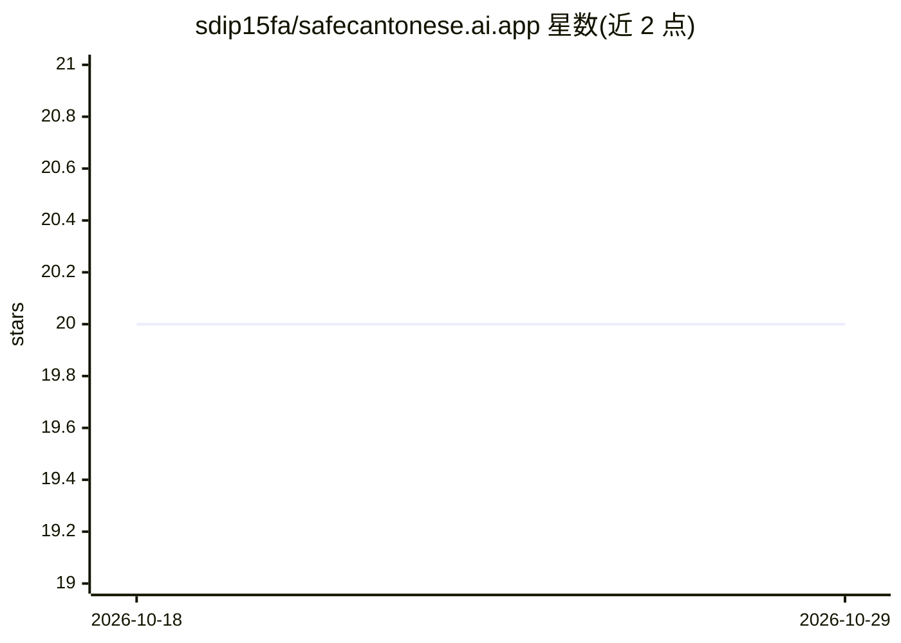

# sdip15fa/safecantonese.ai.app

⭐ 20 · TypeScript · GPL-3.0 · 推送 2025-11-07 · [GitHub](https://github.com/sdip15fa/safecantonese.ai.app) · [官网](https://safecantonese.ai) · 个人维护 · 中文 README

**离线安全的粤语 AI 转录 App：设备本地完成语音转文字**

面向大众的粤语语音转文字移动应用：基于 OpenAI 的 whisper 语音模型并由作者微调，通过 whisper.cpp（whisper.rn 绑定）在设备本地运行转录，音频文件不上传。使用 React Native (Expo) 开发，通过 Google Play 或 GitHub Releases 的 APK 分发；v1.7.0 之前的 APK 需自行加入模型文件并重签名。维护者声明即将参加 DSE 考试、活跃度低，低优先级问题可能不修复。GPL-3.0-or-later 许可。

## 筛选速览

| 维度 | 判定 | 备注 |
|---|---|---|
| AI 角色 | `ai-native` | 本体是模型或模型工具 |
| 许可风险 | `viral` | GPL-3.0 |
| 部署形态 | `None` |  |
| 模型依赖 | — | README 未给出锁定关系 |
| 硬件要求 | — | 无带数字的原话,不猜 |
| 安装摩擦 | `low` | 无编译、无系统依赖或容器化 |
| 成熟度 | — | 结构信号不足 |

## 能力要点

- 基于 whisper 模型（作者微调）的粤语转录
- 完全离线：音频不出设备
- 提供 Play Store 与 GitHub Release APK（v1.7.0 起开箱可用）
- react native (expo) + whisper.cpp (whisper.rn) 技术栈

## 适用场景

- 在设备上离线转录粤语音频，无需上传
- 关注隐私的粤语语音转文字场景
- 通过手机 App 直接完成粤语录音转文字

## 场景标签

`语音识别` · 领域:感知与多模态

## 证据(README 行号)

> L5: This app was made with the aim of bring safer AI Cantonese
> L7: models developed by OpenAI and fine-tuned by me. Your audio files

## 星数曲线

2026-10-18 20 → 2026-10-29 20（+0）

---
*卡片 v1 · prompt 1.4 · 生成 2026-10-28 · 置信度 high · 依据 README sha `944b8a9645f2` · [字段定义](../../DATASET.md)*
