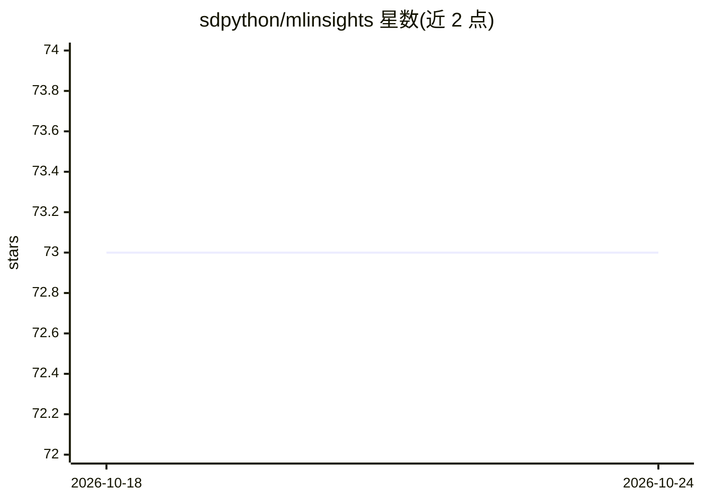

# sdpython/mlinsights

⭐ 73 · Python · MIT · 推送 2026-01-18 · [GitHub](https://github.com/sdpython/mlinsights) · [官网](http://www.xavierdupre.fr/app/mlinsights/helpsphinx/index.html) · 个人维护

**扩展 scikit-learn 的模型与变换器 Python 库**

面向使用 scikit-learn 的开发者的扩展库：提供新的模型、变换器、度量与绘图功能。包含 QuantileLinearRegression（基于 L1 范数的分位数线性回归）、QuantileMLPRegressor（修改版 MLPRegressor）、PredictableTSNE（训练监督模型复现 t-SNE 结果）、PiecewiseRegression（分桶后逐段拟合）、IntervalRegressor（自助法产生置信区间）与 ApproximateNMFPredictor 等。以 Python 包形式在 PyPI 发布，MIT 许可，附文档站点。

## 筛选速览

| 维度 | 判定 | 备注 |
|---|---|---|
| AI 角色 | `ai-native` | 本体是模型或模型工具 |
| 许可风险 | `permissive` | MIT |
| 部署形态 | `None` |  |
| 模型依赖 | — | README 未给出锁定关系 |
| 硬件要求 | — | 无带数字的原话,不猜 |
| 安装摩擦 | `low` | 无编译、无系统依赖或容器化 |
| 成熟度 | — | 结构信号不足 |

## 能力要点

- 分位数回归模型（QuantileLinearRegression / QuantileMLPRegressor）
- PredictableTSNE 用监督模型复现 t-SNE 结果
- 分段回归与自助法置信区间（PiecewiseRegression / IntervalRegressor）
- 近似 NMF 预测器避免重复训练

## 适用场景

- 在现有 scikit-learn 流水线中加入分位数或分段回归模型
- 为回归结果生成置信区间
- 将 t-SNE 降维结果复现为可预测的监督模型

## 场景标签

 · 领域:机器学习工具库

## 证据(README 行号)

> L39: *mlinsights* extends *scikit-learn* with a couple of new models,
> L40: transformers, metrics, plotting. It provides new trainers such as

## 星数曲线

2026-10-18 73 → 2026-10-24 73（+0）

---
*卡片 v1 · prompt 1.4 · 生成 2026-10-24 · 置信度 high · 依据 README sha `6d8e2740e6d3` · [字段定义](../../DATASET.md)*
