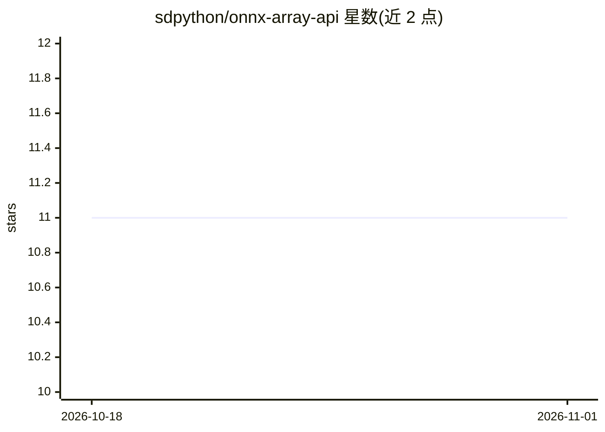

# sdpython/onnx-array-api

⭐ 11 · Python · MIT · 推送 2026-01-18 · [GitHub](https://github.com/sdpython/onnx-array-api) · [官网](https://sdpython.github.io/doc/onnx-array-api/dev/) · 个人维护

**用于创建自定义 ONNX 图的 Python API 集合，加速转换器库开发**

提供三种构建 ONNX 图的 API：匹配 numpy API 的接口（可把按 numpy 风格写的函数转换为 ONNX 并执行，支持 jit 与 eager 模式）、受逆波兰式启发的 Light API（链式一行构建图）、以及 GraphBuilder API（自动命名中间结果、加载保存模型、可扩展已有图）。目标是加速机器学习模型到 ONNX 转换器库的实现。以 MIT 许可发布在 PyPI，附文档站点。

## 筛选速览

| 维度 | 判定 | 备注 |
|---|---|---|
| AI 角色 | `ai-ecosystem` | LLM/agent 周边工具 |
| 许可风险 | `permissive` | MIT |
| 部署形态 | `library` | 以包/库形式分发 |
| 模型依赖 | — | README 未给出锁定关系 |
| 硬件要求 | — | 无带数字的原话,不猜 |
| 安装摩擦 | `low` | 无编译、无系统依赖或容器化 |
| 成熟度 | — | 结构信号不足 |

## 能力要点

- numpy API 可将函数转换为 ONNX 并执行（jit/eager 两种模式）
- Light API 链式调用一行构建图
- GraphBuilder 自动命名中间结果、管理初始化器、可扩展已有图
- 附带文本绘图工具打印 ONNX 图结构

## 适用场景

- 编写机器学习模型到 ONNX 的转换器库
- 以 numpy 风格函数快速生成并验证 ONNX 计算图
- 扩展或修改已有的 ONNX 图

## 场景标签

 · 领域:机器学习工具链/模型转换

## 证据(README 行号)

> L30: **onnx-array-api** implements APIs to create custom ONNX graphs.
> L31: The objective is to speed up the implementation of converter libraries.

## 星数曲线

2026-10-18 11 → 2026-11-01 11（+0）

---
*卡片 v1 · prompt 1.4 · 生成 2026-11-01 · 置信度 mid · 依据 README sha `230b0abd234c` · [字段定义](../../DATASET.md)*
