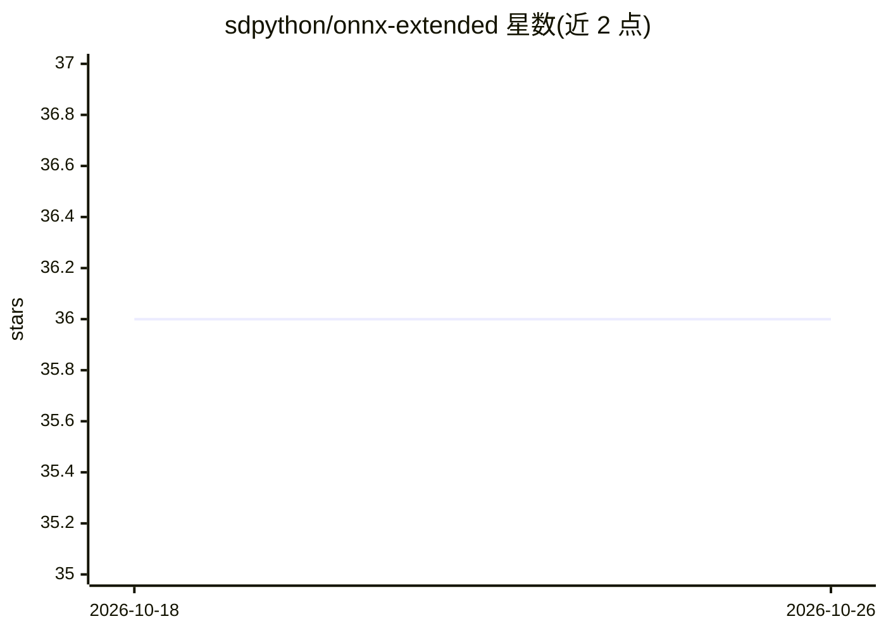

# sdpython/onnx-extended

⭐ 36 · Python · MIT · 推送 2026-02-13 · [GitHub](https://github.com/sdpython/onnx-extended) · [官网](https://sdpython.github.io/doc/onnx-extended/dev/) · 个人维护

**扩展 ONNX 参考实现与 onnxruntime 算子的 Python 库**

为 ONNX ReferenceEvaluator 与 onnxruntime 扩展支持的算子，并以 C++ 实现部分算子的更快版本（如 CReferenceEvaluator 运行 Conv）。同时提供 onnxruntime 自定义 kernel（CPU）注册示例、实验性 Cython 绑定，以及展示 pybind11/cython/openmp/eigen/CUDA 构建方式的示例。PyPI 发布版本仅在 CPU 上工作，启用 CUDA 代码需手动从源码构建，构建时自动检测 CUDA。面向使用 ONNX/onnxruntime 的开发者。

## 筛选速览

| 维度 | 判定 | 备注 |
|---|---|---|
| AI 角色 | `ai-ecosystem` | LLM/agent 周边工具 |
| 许可风险 | `permissive` | MIT |
| 部署形态 | `library` | 以包/库形式分发 |
| 模型依赖 | — | README 未给出锁定关系 |
| 硬件要求 | — | 无带数字的原话,不猜 |
| 安装摩擦 | `high` | 编译与系统依赖俱全 |
| 成熟度 | — | 结构信号不足 |

## 能力要点

- 为 ReferenceEvaluator 与 onnxruntime 扩展算子并提供 C++ 更快实现
- onnxruntime 自定义 kernel（CPU）注册 API
- onnxruntime 的实验性 Cython 绑定
- CUDA 为可选构建：PyPI 版本仅 CPU，需手动构建启用 CUDA/NVTX

## 适用场景

- 在 ONNX 参考实现中以更快速度运行算子
- 为 onnxruntime 添加自定义算子实现
- 参考 pybind11/cython/openmp/eigen/CUDA 的 C++ 扩展构建方式

## 场景标签

`推理引擎` · 领域:训练与推理

## 证据(README 行号)

> L22: **onnx-extended** extends the list of supported operators in onnx
> L23: reference implementation and `onnxruntime
> L141: onnxruntime provides an API to add custom implementation

## 星数曲线

2026-10-18 36 → 2026-10-26 36（+0）

---
*卡片 v1 · prompt 1.4 · 生成 2026-10-25 · 置信度 high · 依据 README sha `86977424da95` · [字段定义](../../DATASET.md)*
