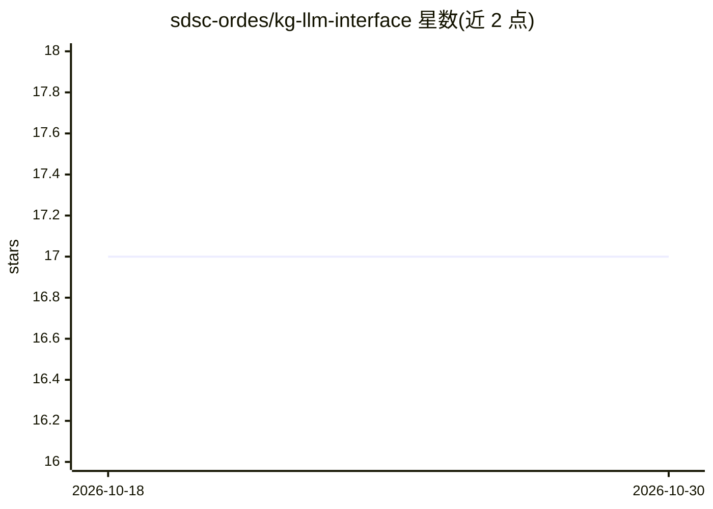

# sdsc-ordes/kg-llm-interface

⭐ 17 · Python · Apache-2.0 · 推送 2025-11-03 · [GitHub](https://github.com/sdsc-ordes/kg-llm-interface) · 组织维护

**面向 RDF 知识图谱的自然语言问答接口**

基于 LangChain 构建的自然语言问答服务：用户用自然语言向 RDF 知识图谱提问，系统检索图谱数据并经 LLM 生成回答。数据准备通过 Pipeline 完成：insert_triples 将 RDF 文件（rdflib 支持的格式）导入 SPARQL 端点，chroma_build 从 SPARQL 端点构建 ChromaDB 向量索引。聊天服务可由 uvicorn 独立部署（端口 8001），默认使用 OpenAI，也可通过 openai_api_base 指向 llamafile/openllm/localGPT 等开源 LLM 服务器。使用 uv 管理依赖，Kubernetes 部署标注为 WIP 未完成。

## 筛选速览

| 维度 | 判定 | 备注 |
|---|---|---|
| AI 角色 | `ai-native` | 本体是模型或模型工具 |
| 许可风险 | `permissive` | Apache-2.0 |
| 部署形态 | `None` |  |
| 模型依赖 | — | README 未给出锁定关系 |
| 硬件要求 | — | 无带数字的原话,不猜 |
| 安装摩擦 | `low` | 无编译、无系统依赖或容器化 |
| 成熟度 | `idea` | |

## 能力要点

- 自然语言问答接口对接 RDF 知识图谱与 SPARQL 端点
- insert_triples / chroma_build 两条数据准备流水线
- 默认 OpenAI，可通过 openai_api_base 接入开源 LLM（llamafile/openllm/localGPT）
- uvicorn 独立服务部署（chromaDB client 模式 + RDF 文件）

## 适用场景

- 我有一个 RDF 数据集，想直接用自然语言提问
- 把 SPARQL 端点中的图谱数据建成向量索引供问答检索
- 在小型数据集上快速部署一个知识图谱问答服务

## 场景标签

`知识图谱` · 领域:知识与检索

## 证据(README 行号)

> L2: Langchain-powered natural language interface to RDF knowledge-graphs.
> L22: The chat configuration (`config.chat.ChatConfig`) uses OpenAI by default, however you can run this tool with open s
> L35: The server can be deployed as a standalone service using the script `scripts/standalone_server.sh`. It will start a

## 星数曲线

2026-10-18 17 → 2026-10-30 17（+0）

---
*卡片 v1 · prompt 1.4 · 生成 2026-10-29 · 置信度 high · 依据 README sha `38b711c7dded` · [字段定义](../../DATASET.md)*
