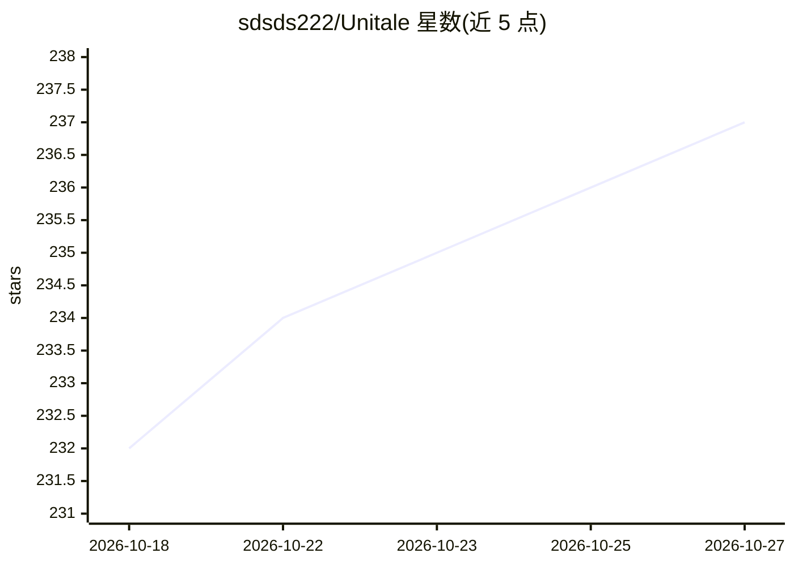

# sdsds222/Unitale

⭐ 237 · HTML · MIT · 推送 2026-07-05 · [GitHub](https://github.com/sdsds222/Unitale) · [官网](https://www.bilibili.com/video/BV1AkzLB7E8M/?spm_id_from=333.1387.homepage.video_card.click) · 个人维护 · 中文 README

**浏览器内一键生成多角色有声书的 AI 工作台**

基于 IndexTTS 与 Qwen3TTS 的有声书制作工具，本体为跨平台浏览器页面，无需本地配置环境。LLM 拆解剧本、区分旁白与角色并推断情绪，自动编排音效插入、BGM 切换与场景滤波器；可分析文本生成音色描述并用 Qwen3TTS 音色设计模型生成参考音频，导出 wav 成品及带背景图片的 mp4 视频。需用户自行配置 OpenAI 通用接口的 LLM 与云原生 TTS 项目 URL；支持工程文件导入导出与 Prompt、音色、素材库自定义。

## 筛选速览

| 维度 | 判定 | 备注 |
|---|---|---|
| AI 角色 | `ai-native` | 本体是模型或模型工具 |
| 许可风险 | `permissive` | MIT |
| 部署形态 | `None` |  |
| 模型依赖 | — | README 未给出锁定关系 |
| 硬件要求 | — | 无带数字的原话,不猜 |
| 安装摩擦 | `low` | 无编译、无系统依赖或容器化 |
| 成熟度 | — | 结构信号不足 |

## 能力要点

- LLM 自动拆解剧本、区分角色并推断情绪生成 TTS 提示
- 自动编排 SFX 插入时间点、BGM 切换与场景音频滤波器
- 基于 Qwen3TTS 音色设计模型从描述文本生成角色音色
- 浏览器内跨平台使用，可导出 wav 与带背景图的 mp4

## 适用场景

- 把小说文本自动转换成多角色配音的有声书
- 制作带音效、配乐与场景声场效果的有声故事
- 为播客或有声内容生成并微调角色音色

## 场景标签

`语音合成` · 领域:内容生成

## 证据(README 行号)

> L10: 一个基于Indextts和Qwen3TTS的 AI Agent 有声书制作工具。利用 LLM 自动拆解剧本与识别情绪，集成多角色 TTS 语音合成（可智能分析音色并使用Qwen3TTS语音设计模型从音色描述文本生成音色），支持音效
> L75: 一个自制的 AI 有声故事生成工作台。利用 LLM 深度理解小说文本，实现了音效自动插入、BGM 自动切换、场景滤波器自动设置以及多角色情绪自动演绎的完整自动化编排，在浏览器中一键生成有声音频作品。

## 星数曲线

2026-10-18 232 → 2026-10-27 237（+5）

---
*卡片 v1 · prompt 1.4 · 生成 2026-10-22 · 置信度 high · 依据 README sha `dde4c258d0b1` · [字段定义](../../DATASET.md)*
