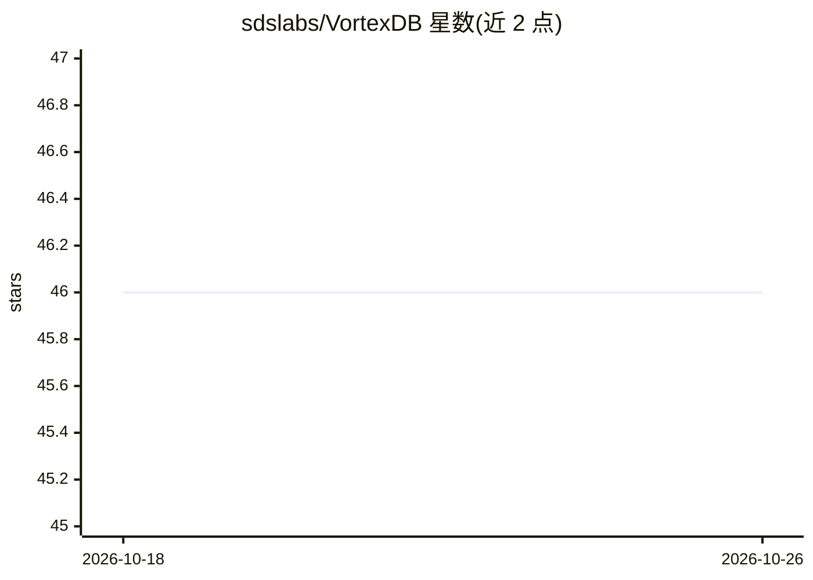

# sdslabs/VortexDB

⭐ 46 · Rust · Apache-2.0 · 推送 2026-10-20 · [GitHub](https://github.com/sdslabs/VortexDB) · [官网](https://vortex-db.sdslabs.co/) · 组织维护

**Rust 编写的轻量向量数据库，为 AI 应用提供相似度检索**

用 Rust 从零实现的向量数据库，为 AI 应用提供相似度检索后端。索引层支持 Flat（精确暴力检索）、KD-Tree（低维空间划分）与 HNSW（大规模近似最近邻）三种可插拔实现，距离度量覆盖欧氏、曼哈顿、汉明与余弦。存储层通过 StorageEngine trait 抽象，提供 RocksDB 持久化与 InMemory 两种后端。对外提供 Axum 构建的 HTTP REST 服务、gRPC 服务（带 API key 鉴权与角色控制）及 Ratatui TUI 客户端，通过 Dockerfile/docker-compose 启动统一服务。面向需要自托管向量检索的开发者。

## 筛选速览

| 维度 | 判定 | 备注 |
|---|---|---|
| AI 角色 | `ai-ecosystem` | LLM/agent 周边工具 |
| 许可风险 | `permissive` | Apache-2.0 |
| 部署形态 | `self-host` | docker 或自建部署 |
| 模型依赖 | — | README 未给出锁定关系 |
| 硬件要求 | — | 无带数字的原话,不猜 |
| 安装摩擦 | `low` | 无编译、无系统依赖或容器化 |
| 成熟度 | — | 结构信号不足 |

## 能力要点

- 三种可插拔索引：Flat / KD-Tree / HNSW
- 存储层抽象，RocksDB 持久化与 InMemory 后端可选
- HTTP 与 gRPC 双服务，API key 支持 readwrite/readonly 角色鉴权
- 提供 Dockerfile 与 docker-compose 统一启动，附 TUI 客户端

## 适用场景

- 为语义搜索/推荐等 AI 应用提供自托管向量存储与检索
- 小数据集精确检索或大规模近似最近邻检索
- 通过 REST 或 gRPC 接入现有服务做相似度查询

## 场景标签

`向量数据库` · 领域:知识与检索

## 证据(README 行号)

> L8: **VortexDB** - A vector database built from scratch in Rust 🦀. VortexDB is designed for efficient similarity search 
> L27: The indexing layer provides efficient vector similarity search with pluggable index implementations. VortexDB suppo

## 星数曲线

2026-10-18 46 → 2026-10-26 46（+0）

---
*卡片 v1 · prompt 1.4 · 生成 2026-10-25 · 置信度 high · 依据 README sha `f153691b10f1` · [字段定义](../../DATASET.md)*
