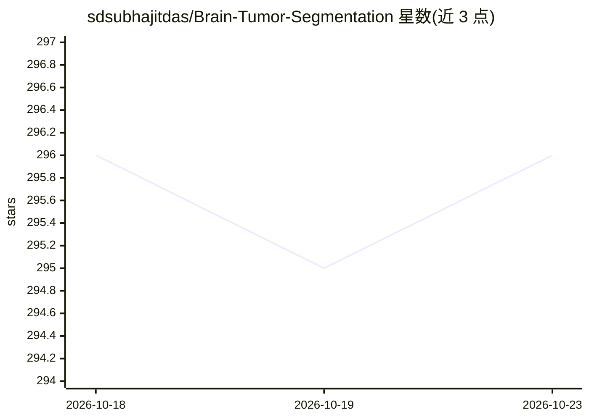

# sdsubhajitdas/Brain-Tumor-Segmentation

⭐ 296 · Jupyter Notebook · MIT · 推送 2026-10-21 · [GitHub](https://github.com/sdsubhajitdas/Brain-Tumor-Segmentation) · [官网](https://bts.subhajitdas.me/) · 个人维护

**用 U-Net 对脑肿瘤 MRI 图像生成分割掩码的 PyTorch 项目**

基于 U-Net 架构的脑肿瘤图像分割项目：读取 512×512×1 的 T1 加权增强 MRI 图像（3064 张、三类脑肿瘤数据集），生成肿瘤分割掩码。训练采用 Torchvision 数据增强（翻转/旋转）、学习率 plateau 衰减，100 epochs 后在 600 张测试图上取得平均 Dice 0.74461。提供 git clone + pip 依赖安装、数据集下载脚本与 api.py 命令行推理（单文件或文件夹批量），另有浏览器 Live Demo 与 Jupyter/Tensorboard 支持。面向深度学习开发与科研用户。

## 筛选速览

| 维度 | 判定 | 备注 |
|---|---|---|
| AI 角色 | `ai-native` | 本体是模型或模型工具 |
| 许可风险 | `permissive` | MIT |
| 部署形态 | `library` | 以包/库形式分发 |
| 模型依赖 | — | README 未给出锁定关系 |
| 硬件要求 | — | 无带数字的原话,不猜 |
| 安装摩擦 | `medium` | 含编译或系统依赖之一 |
| 成熟度 | — | 结构信号不足 |

## 能力要点

- U-Net 架构生成脑肿瘤分割掩码
- api.py 支持单图与文件夹批量推理
- 提供数据集下载/解压/抽取脚本
- 浏览器 Live Demo 可上传 MRI 切片查看预测掩码

## 适用场景

- 对脑部 MRI 图像生成肿瘤区域分割掩码
- 复现或学习 U-Net 医学图像分割训练流程
- 在本地批量处理 MRI 图像并输出掩码结果

## 场景标签

`目标检测` · 领域:感知与多模态

## 证据(README 行号)

> L11: This project uses U-Net Architecture to create segmentation masks for brain tumor images.
> L13: **Try the live demo →** Upload an MRI slice (or pick a sample study) and see the model's predicted tumor mask in yo

## 星数曲线

2026-10-18 296 → 2026-10-23 296（+0）

---
*卡片 v1 · prompt 1.4 · 生成 2026-10-21 · 置信度 high · 依据 README sha `44ebd7931952` · [字段定义](../../DATASET.md)*
