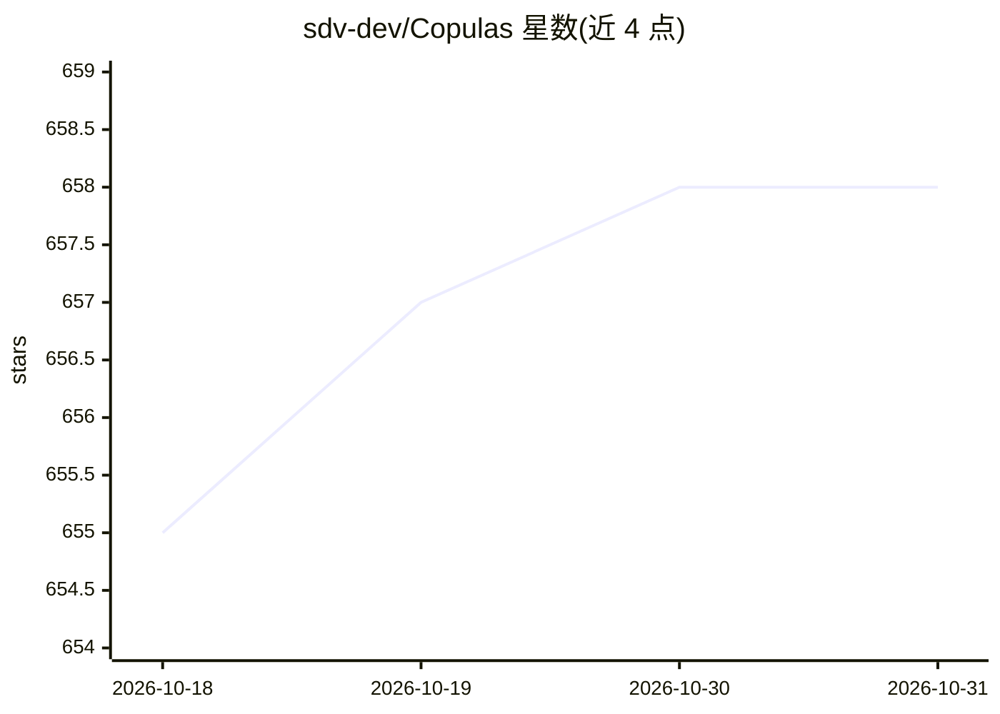

# sdv-dev/Copulas

⭐ 658 · Python · NOASSERTION · 推送 2026-10-30 · [GitHub](https://github.com/sdv-dev/Copulas) · [官网](https://sdv.dev/Copulas/) · 组织维护

**用 copula 函数建模多变量分布并采样合成表格数据**

Python 库，读取数值表格数据，用 copula 函数（含 Gaussian、Vine、Archimedean 等）学习联合分布并采样生成保持统计性质的合成数据。提供 1D 直方图、2D/3D 散点图对比真实与合成数据，并可访问与调整模型内部参数。属于 DataCebo 维护的 Synthetic Data Vault（SDV）生态的组成库，起源于 MIT Data to AI Lab（2018 年）。通过 pip/conda 安装，附 Colab 教程笔记本。

## 筛选速览

| 维度 | 判定 | 备注 |
|---|---|---|
| AI 角色 | `ai-native` | 本体是模型或模型工具 |
| 许可风险 | `none` | NOASSERTION |
| 部署形态 | `library` | 以包/库形式分发 |
| 模型依赖 | — | README 未给出锁定关系 |
| 硬件要求 | — | 无带数字的原话,不猜 |
| 安装摩擦 | `low` | 无编译、无系统依赖或容器化 |
| 成熟度 | — | 结构信号不足 |

## 能力要点

- 支持 Gaussian、Vine、Archimedean 等多种 copula
- 从表格数据学习分布并采样合成数据
- 1D/2D/3D 可视化对比真实与合成数据
- 可访问与修改模型学习到的参数

## 适用场景

- 为表格数据生成统计性质一致的合成数据
- 建模多变量联合分布并采样
- 可视化对比合成数据与真实数据的质量

## 场景标签

 · 领域:合成数据/统计建模

## 证据(README 行号)

> L16: **Copulas** is a Python library for modeling multivariate distributions and sampling from them
> L19: generate new synthetic data following the same statistical properties.

## 星数曲线

2026-10-18 655 → 2026-10-31 658（+3）

---
*卡片 v1 · prompt 1.4 · 生成 2026-10-21 · 置信度 high · 依据 README sha `202feece0da8` · [字段定义](../../DATASET.md)*
