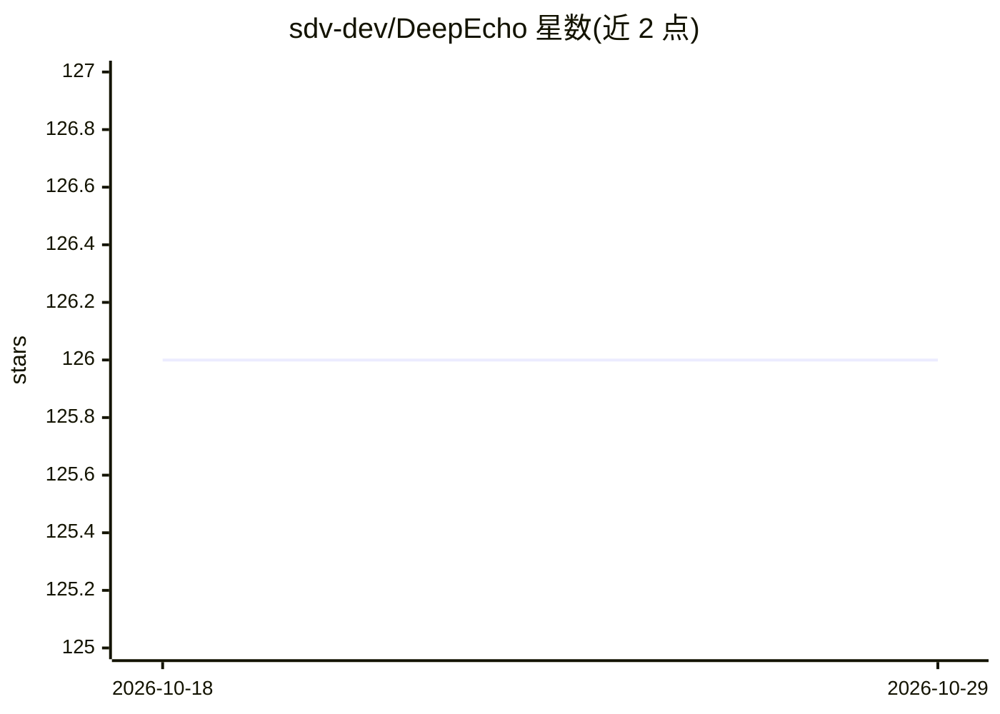

# sdv-dev/DeepEcho

⭐ 126 · Python · NOASSERTION · 推送 2026-10-26 · [GitHub](https://github.com/sdv-dev/DeepEcho) · 组织维护

**混合类型多变量时间序列的合成数据生成 Python 库**

DeepEcho 是 SDV（Synthetic Data Vault）项目的组成部分，由 DataCebo 维护，用于对混合类型、多变量时间序列建模并生成相似的合成数据。提供基于经典统计建模与深度学习的多种模型（含 PARModel），以及跨数据集、多指标评测的基准框架；研究者可按 model/sample API 提交新方法参与评测。随 SDV 自动安装，也可用 pip/conda 独立安装；模型可选启用 CUDA，README 提示小数据集下 CUDA 开销可能高于并行收益。软件自述处于 Pre-Alpha 阶段。

## 筛选速览

| 维度 | 判定 | 备注 |
|---|---|---|
| AI 角色 | `ai-native` | 本体是模型或模型工具 |
| 许可风险 | `none` | NOASSERTION |
| 部署形态 | `library` | 以包/库形式分发 |
| 模型依赖 | — | README 未给出锁定关系 |
| 硬件要求 | — | 无带数字的原话,不猜 |
| 安装摩擦 | `medium` | 含编译或系统依赖之一 |
| 成熟度 | `idea` | |

## 能力要点

- 基于经典统计与深度学习的时间序列合成模型（如 PARModel）
- 跨多数据集、多指标的基准评测框架
- 支持按 model/sample API 提交新模型并参与评测
- 可设置 epochs 与启用 CUDA

## 适用场景

- 为多变量时间序列数据集生成保持统计性质的合成数据
- 在 SDV 流程中做时间序列建模与采样
- 研究者提交并评测新的时间序列合成方法

## 场景标签

 · 领域:数据科学/合成数据生成

## 证据(README 行号)

> L17: **DeepEcho** is a **Synthetic Data Generation** Python library for **mixed-type**, **multivariate
> L20: 1. Multiple models based both on **classical statistical modeling** of time series and the latest

## 星数曲线

2026-10-18 126 → 2026-10-29 126（+0）

---
*卡片 v1 · prompt 1.4 · 生成 2026-10-23 · 置信度 high · 依据 README sha `19d8394cc178` · [字段定义](../../DATASET.md)*
