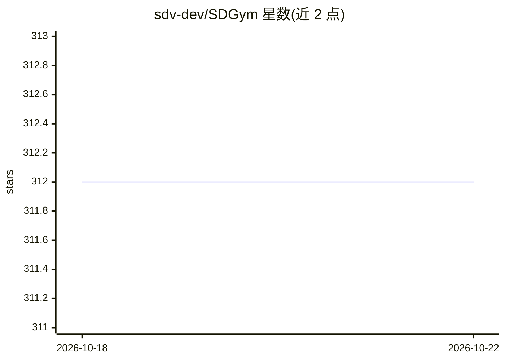

# sdv-dev/SDGym

⭐ 312 · Python · NOASSERTION · 推送 2026-10-19 · [GitHub](https://github.com/sdv-dev/SDGym) · 组织维护

**合成数据生成方法基准评测框架，测性能/内存/质量**

DataCebo 维护的 Synthetic Data Vault 生态组成部分，用于对多种合成数据建模技术（经典统计、深度学习等）做基准测试：支持选用 SDV 项目的合成器或自定义模型，在公开数据集或自有/S3 私有数据集上运行，度量性能、内存占用以及合成数据的质量与隐私指标。以 Python 库形式提供，通过 pip 或 conda 安装，提供单表基准 API 与数据集浏览工具。项目源于 MIT Data to AI Lab，2020 年起由 DataCebo 公司维护。

## 筛选速览

| 维度 | 判定 | 备注 |
|---|---|---|
| AI 角色 | `ai-ecosystem` | LLM/agent 周边工具 |
| 许可风险 | `none` | NOASSERTION |
| 部署形态 | `library` | 以包/库形式分发 |
| 模型依赖 | — | README 未给出锁定关系 |
| 硬件要求 | — | 无带数字的原话,不猜 |
| 安装摩擦 | `low` | 无编译、无系统依赖或容器化 |
| 成熟度 | — | 结构信号不足 |

## 能力要点

- 跨合成器基准测试，度量性能、内存与质量/隐私指标
- 支持 SDV 生态合成器与自定义训练/采样逻辑的合成器
- 内置公开数据集，支持本地与 Amazon S3 私有数据集

## 适用场景

- 对比多种合成数据生成方法的性能与内存开销
- 评估自己的合成器模型相对基线方法的表现
- 在私有数据集上做合成数据质量与隐私评测

## 场景标签

 · 领域:合成数据/评测

## 证据(README 行号)

> L15: The Synthetic Data Gym (SDGym) is a benchmarking framework for modeling and generating
> L16: synthetic data. Measure performance and memory usage across different synthetic data modeling

## 星数曲线

2026-10-18 312 → 2026-10-22 312（+0）

---
*卡片 v1 · prompt 1.4 · 生成 2026-10-21 · 置信度 high · 依据 README sha `db96d36dabb4` · [字段定义](../../DATASET.md)*
